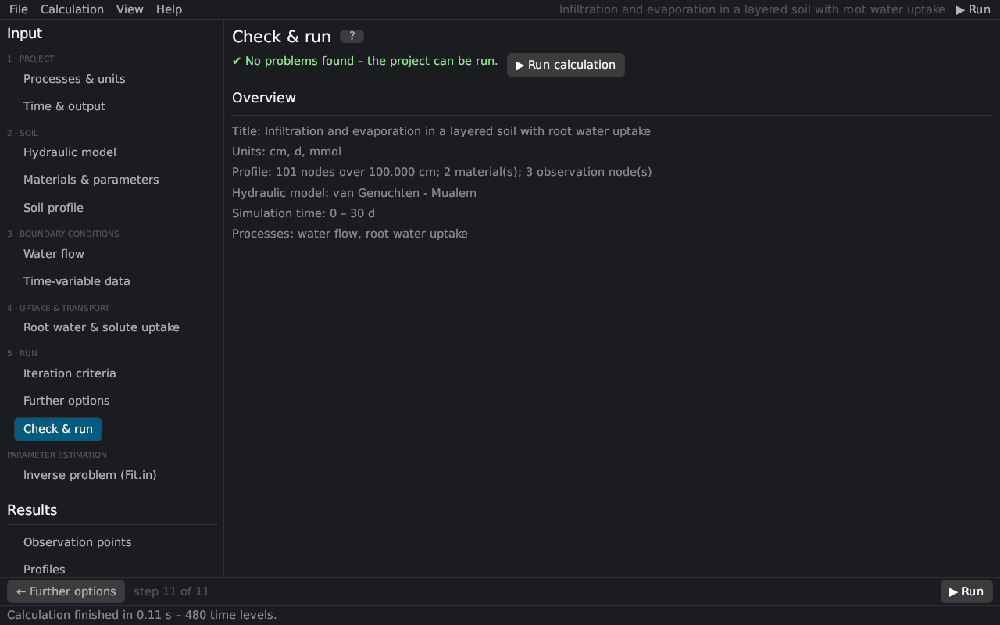

# Check & run
keywords: check; run; validation; problems; summary; start calculation; F5; stop

The last page of the input workflow checks the project, shows an overview and runs the calculation (F5 or *▶ Run* do the same from any page).

## Checks

The project is checked before every run; problems are listed in red and the calculation does not start until they are solved. Checked are, among others:

- the profile: at least 3 and at most 1001 nodes, depths increasing from top to bottom, every node refers to a defined material;
- the materials: θs > θr, α > 0 and n > 1 (except Brooks–Corey and Kosugi), Ks > 0;
- the time: final time > initial time, Δt > 0, dtMin > 0, dtMax ≥ dtMin;
- time-variable boundary conditions need at least one record;
- meteorological data: records present, measurement heights above the zero-plane displacement, cloudiness parameters set;
- solute and heat parameters for all materials;
- the hysteresis state matches the number of nodes;
- the further options (τw ≥ 0, centrifuge speed > 0, positive density and viscosity ratios; not with dual permeability);
- an inverse problem needs inverse settings.

After writing a HYDRUS-1D project, the page also lists the settings that HYDRUS-1D cannot store.

## Overview

Title, units, number of nodes, depth, materials and observation nodes, the hydraulic model, the simulated period and the processes.

## Running

*▶ Run calculation* starts the simulation in the background; the status bar shows the progress. *■ Stop* (menu bar or *Calculation → Stop*) ends it and keeps the results computed so far. When the run has finished, the page *Profiles* opens. With an inverse problem, *Run* starts the [parameter estimation](inverse_page).

If a run stops because the iteration does not converge, see [questions and problems](faq#convergence).
