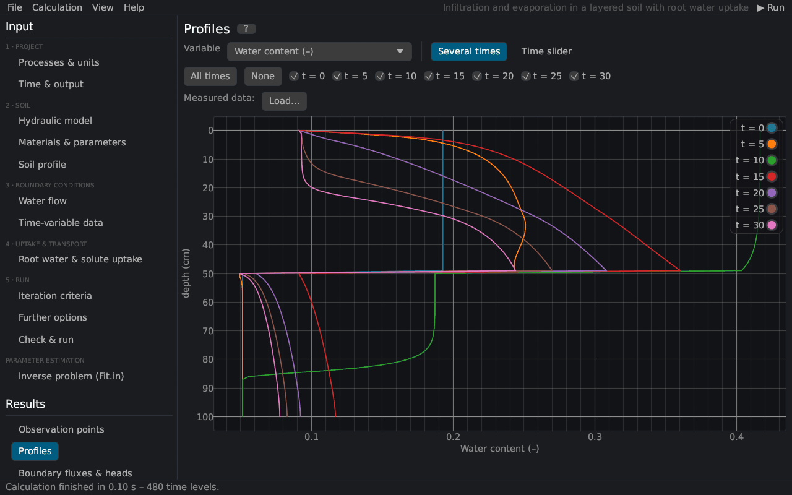

# Rusteau-1D Help
keywords: help; contents; start page; overview

Rusteau-1D simulates the one-dimensional movement of water, heat and multiple solutes in variably saturated soils. Its numerical engine is a port of the HYDRUS-1D code [@simunek2009], verified against the results of HYDRUS-1D 4.17 [@simunek2013]. This help describes the interface page by page, the equations behind every calculation and the scientific sources they are based on.

## How to use this help

- **Contents** (left panel): the topics in the order of the help of HYDRUS-1D – introduction, projects and files, the input pages, the results pages, the theory and the reference part.
- **Index**: keywords and section headings in alphabetical order; type a few letters to filter.
- **Search**: full-text search; all words must occur in a topic.
- **F1** or the **?** button next to a page title opens the topic of the page you are working on. Resting the mouse on any input shows a short description (tooltip).
- Blue text links to other topics; author–year citations such as [@vanGenuchten1980] link to the [References](references) (resting the mouse on a citation shows the full reference).
- **Open in web browser** writes the whole help as HTML pages (offline) and opens them in your web browser; *Help → Export the HTML help…* writes them into the folder *Rusteau-1D help* of a folder of your choice.

## Chapters

| Chapter | What you find there |
|---|---|
| [Introduction](introduction) | what the program does, [getting started](getting_started), the [main window](interface), the [workflow](workflow) of a project, [units](units) and the [relation to HYDRUS-1D](hydrus_relation) |
| [Projects and files](projects) | project files, HYDRUS-1D import and export, [examples](examples), [output files](output_files), the [command line program](cli) |
| Input (pre-processing) | one topic per input page, from [Processes & units](processes) to [Check & run](check_run) and the [parameter estimation](inverse_page) |
| Results (post-processing) | [observation points](res_obs), [profiles](res_profiles), [boundary fluxes](res_fluxes), [soil hydraulic properties](res_soilprops), [run-time information](res_runtime), [mass balance](res_balance), [parameter estimation results](res_inverse), [measured data](measured_data), the [figure editor](figures) for publication figures and the [comparison of runs](run_comparison) |
| Theory and equations | the governing equations: [water flow](th_richards), [soil hydraulic models](th_hydraulic_models), [hysteresis](th_hysteresis), [root water uptake](th_root_uptake), [boundary conditions](th_bc_water), [evapotranspiration](th_penman), [heat](th_heat) and [solute transport](th_solute), the [numerical solution](th_numerics) and the [parameter estimation](th_inverse) |
| Reference | [symbols and glossary](glossary), [keyboard and mouse](shortcuts), [questions and problems](faq), [references](references), [credits and license](credits) |

> Rusteau-1D is an independent project. It is not affiliated with or endorsed by PC-Progress or the authors of HYDRUS. The name HYDRUS is used only to identify the program whose numerical methods Rusteau follows.
