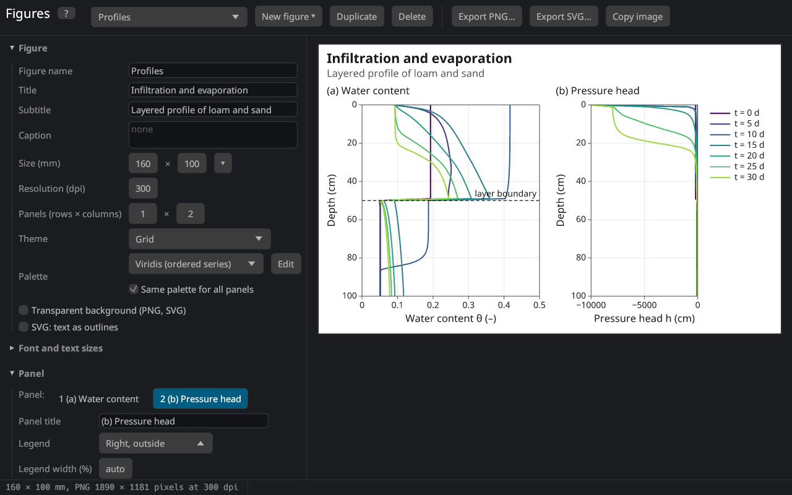
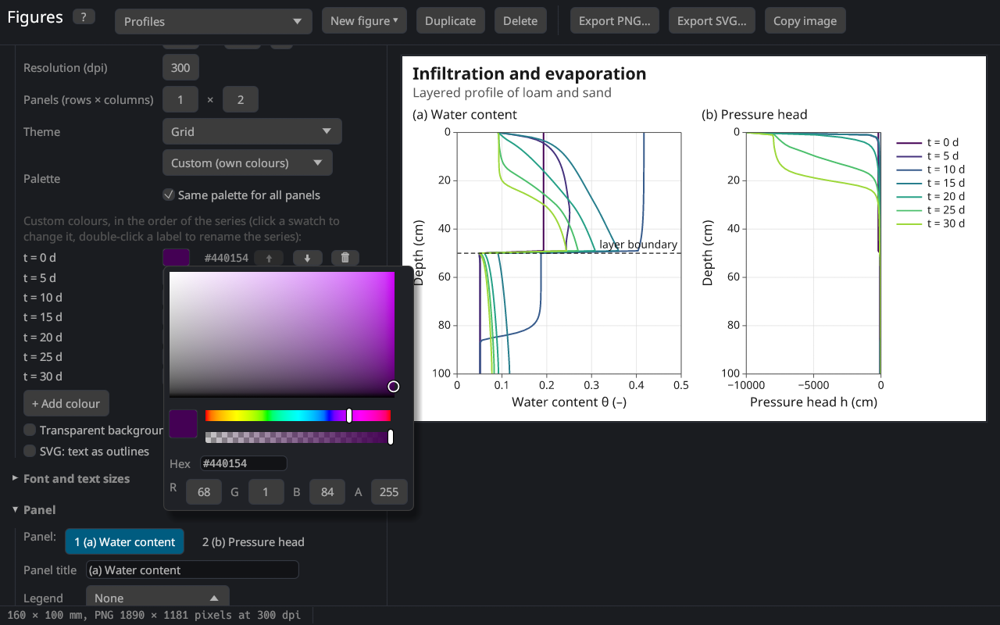
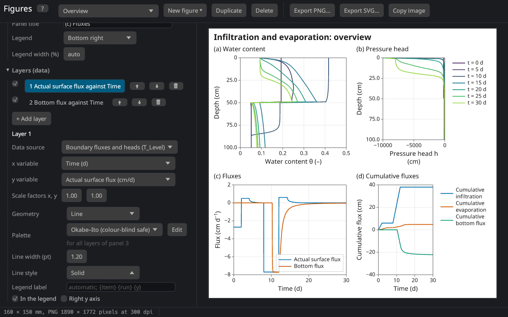
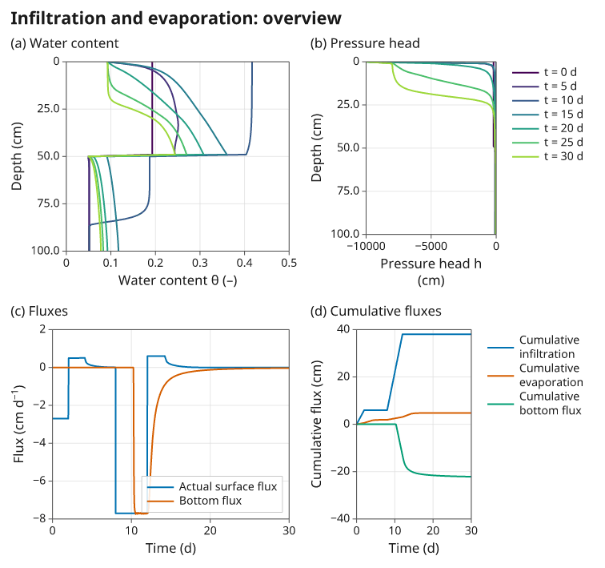

# Figure editor
keywords: figures; figure editor; diagram; plot; chart; graph; publication figure; PNG; SVG; export; title; subtitle; caption; annotation; legend; axis; logarithmic axis; panel; layer; template; font; Noto Sans; palette; colour; theme; data file; CSV; markup; symbols; dpi; resolution

The figure editor makes diagrams of the results, the input and measured data for reports, papers and presentations: with a title, subtitle and caption, several panels, axis titles with sub- and superscripts, annotations, a choice of fonts, colours and line styles, and the export as PNG or SVG. It opens in a window of its own with **Results → Figures** in the list on the left or **View → Figures (new window)**. The figures belong to the project: they are saved in the `.h1dr` file (the HYDRUS-1D project files cannot store them).



## The window

| Part | Contents |
|---|---|
| tool bar | the figure shown (list of the figures of the project), **New figure** (templates), **Duplicate**, **Delete**, **Export PNG…**, **Export SVG…**, **Copy image** |
| left | the settings, in sections: Figure, Font and text sizes, Panel, Layers (data), Axes, Annotations, Data files, Runs for comparison, Symbols and markup |
| right | the preview: the figure as it will be exported, at its proportions |
| status bar | under the mouse: the panel and the values of its axes (and the relative position 0–1); otherwise the size of the PNG and notes about the data |

Every change shows at once in the preview. A click on a panel of the preview selects it for the settings on the left. F1 or **?** shows this topic.

## Building a figure

1. **New figure ▾** offers templates: water content and pressure head profiles, concentration profiles, observation nodes, breakthrough curves, surface and bottom fluxes, the cumulative water balance, the atmospheric forcing, the retention curve and conductivity, the mass balance error, simulated against measured data, observed and fitted values of a parameter estimation, the comparison of runs and an overview with four panels. Templates that need other data (solutes, observation nodes, measured data, kept runs) are greyed out.
2. Change the size, the title and the look in the section **Figure**.
3. Choose the data of each panel in **Layers (data)**: the source, the x and the y variable.
4. Adjust the axes, add annotations, and export.

## Figure

| Setting | Meaning |
|---|---|
| Figure name | name in the list and the default file name; not drawn |
| Title, Subtitle | above the figure (the subtitle smaller, grey); empty: none |
| Caption | under the figure, wrapped to its width |
| Size (mm) | width × height in millimetres; **▾** offers common sizes (1, 1.5 and 2 journal columns of 85, 120 and 170 mm, a 16:9 slide, A4 landscape) |
| Resolution (dpi) | dots per inch of the PNG (300 for print, 150–200 for screens) |
| Panels (rows × columns) | number of diagrams in a grid (up to 4 × 4) |
| Theme | Grid (frame and light grid), Classic (axis lines left and bottom), Minimal (no frame), Dark (presentations) |
| Palette | colours of the series in order: Okabe–Ito, Tableau 10, Viridis, Grey, or Custom (your own list, see [custom colours](figures#custom-colours)); **Edit** turns the palette into a custom one with the same colours; with several panels, **Same palette for all panels** (see [below](figures#panel-palettes)) |
| Transparent background | the exported files have no background |
| SVG: text as outlines | see [Export](figures#export) |

The size is the size in the document: the fonts are given in points (1 pt = 1/72 inch ≈ 0.35 mm) and keep their size whatever the resolution. Journals usually ask for text of at least 6–8 pt at the printed size; the defaults (8.5 pt for the numbers, 10 pt for the axis titles) fit a figure of 85–170 mm.

The series of all layers of a panel take the colours of the palette one after the other: two layers with one series each get the first and the second colour. Viridis and Grey spread their range over all series of the panel.

The palettes follow the advice to use colours that remain distinguishable for readers with a colour vision deficiency and in print [@crameri2020]: Okabe–Ito, the default, is the palette of [@okabeIto2008], recommended for scientific figures by [@wong2011]. Viridis [@smith2015viridis] is a perceptually uniform sequence for series in an order such as print times or depths. Grey suits black-and-white print.

### One palette per panel {#panel-palettes}

With several panels, **Same palette for all panels** (on at first) gives the whole figure the palette chosen in the section Figure. Off, every panel has its own palette, e.g. Viridis for the profiles at the print times and Okabe–Ito for the fluxes beside them: it is chosen in **Layers (data)** under the geometry of the layer, and applies to all layers of the selected panel. When the option is switched off, every panel starts with the palette of the figure. With one panel (1 × 1) the option is not shown and the palette of the figure applies.

### Custom colours {#custom-colours}

With the palette **Custom (own colours)** the series take the colours of a list of your own, in order (after the last colour the list starts again). The list is shown under the palette: in the section Figure, or in Layers (data) when the panels have their own palettes (each panel then has its own list). **Edit** next to a palette turns it into a custom palette with the same colours, so the figure looks the same until a colour is changed: the cycle of Okabe–Ito or Tableau 10, or one colour per series from Viridis or Grey (as many as the panel with the most series has). When Custom is chosen in the list, an empty list starts with the colours of the palette chosen before.

Each row shows the legend labels of the series that take the colour in the selected panel (resting the mouse on them lists the series of all panels; *not used* when no series takes it), the swatch and the code; ⬆ ⬇ change the order, 🗑 removes a colour, **+ Add colour** adds one.

A double click on a legend label renames the series in the legend of the selected panel, e.g. "Cumulative infiltration" to "Infiltration": Enter or a click elsewhere applies the name, Escape cancels it, and an empty name brings back the automatic label. The name belongs to the series (it is stored with the automatic label of the series) and is kept when the colours change; the **Legend label** of a layer, with `{item}`, `{run}` and `{y}`, names all series of the layer at once.

A click on a swatch opens the colour picker, as in the developer tools of web browsers: the field sets the saturation (left to right) and the brightness (top to bottom), the sliders below the hue and the opacity (alpha); the code can be typed as `#rrggbb` or `#rrggbbaa`, and R, G, B, A as numbers 0–255. The same picker sets the colour of an annotation.



## Font and text sizes

**Font** offers Noto Sans, bundled with the program, and the font families installed on the computer. Noto Sans has all the symbols of soil physics: Greek letters, sub- and superscript digits and letters, the mathematical signs and arrows (from Noto Sans Math). Characters that a chosen system font lacks are taken from Noto Sans, so θ, ≤ or ⁻¹ always appear. The sizes of the title, subtitle, caption, panel titles, axis titles, tick labels and legend are set separately.

## Text: markup and symbols {#markup}

All texts (titles, axis titles, legend labels, annotations) understand the markup of this help:

| Write | Shows |
|---|---|
| `θ_{s}` | θₛ (subscript) |
| `cm^{3} cm^{−3}` | cm³ cm⁻³ (superscript) |
| `*K*` | italic |
| `**Loam**` | bold |
| `\*` | a literal * |

A line break in the title, the caption or an axis title starts a new line. The section **Symbols and markup** has buttons for the common symbols (θ, α, ψ, Δ, °, ±, ≤, √, ∂, →, ², ⁻¹, ₛ …): a click copies the symbol, Ctrl+V pastes it.

## Panels and layers {#layers}

A panel is one diagram with its axes, legend and annotations. Its title (e.g. "(a) Loam"), the position of its legend (a corner inside the plot area, outside on the right, below, or none) and the **Legend width** are set in the section **Panel**; with several panels the row of numbers selects the panel. The legend width is the width of the legend in percent of the width of the plot area (for a legend outside on the right: of the plot area without it): at 90 % the legend spans almost the whole plot area. The entries are arranged in rows of as many columns as fit, and labels too long for one column are wrapped at blanks (a word longer than the column stays whole). **auto** (0, at first) makes the legend as wide as its entries, in one column (below the plot: in rows across the panel); labels are wrapped only where the legend would be wider than the plot area (on the right: than half of it).

A panel shows one or more **layers**. A layer takes its x and y values from two columns of a data source; it draws one series for each selected item (observation node, print time, material, data set) and run. The check box shows or hides a layer, ⬆ ⬇ change the drawing order (later layers are drawn on top), 🗑 removes it, **+ Add layer** adds a copy of the selected one.



### Data sources

| Source | Items | Variables |
|---|---|---|
| Boundary fluxes and heads (T_Level) | – | time, time step, iterations; potential and actual surface flux, bottom flux, transpiration, runoff, precipitation; their cumulative values, infiltration, evaporation; heads at the surface, in the root zone and at the bottom; storage, snow; temperatures; Peclet and Courant numbers; per solute: fluxes, cumulative fluxes, concentrations and root uptake |
| Observation nodes | nodes | time; h, θ, temperature, flux, concentrations (and the values of the matrix / immobile region) |
| Profiles at the print times | print times | depth; h, θ, K, C, flux, root water uptake, v/Ks, temperature, concentrations, sorbed concentrations, node number |
| Mass balance | – | time; water volume, absolute and relative balance error, fluxes; per solute: mass and balance error; volumes of the sub-regions |
| Atmospheric records (A_Level), extended fluxes (T_Level1), meteorological output | – | the columns of these tables (when they were written) |
| Soil hydraulic properties | materials | \|h\|, pF; θ, K, C (and the main wetting branch with hysteresis) |
| Time-variable boundary data | – | the input records: precipitation, potential evaporation and transpiration, hCritA, bottom flux and head, surface head, temperatures, concentrations, rooting depth |
| Soil profile: initial condition | – | depth; initial h or θ, material, sub-region, root distribution, scaling factors, temperature, concentrations |
| Measured data | data sets | x and y of the [measured data](measured_data) loaded on the results pages |
| Parameter estimation: observed and fitted | measurement sets | x, observed, fitted, residual (after a [parameter estimation](res_inverse)) |
| Data file | – | the columns of an [imported table](figures#data-files) |

The menus of the x and y variables list the columns with their units, grouped (time and position, water, cumulative water fluxes, solutes, heat, numerics). When the source changes, the variables stay if the new source has them. **Scale factors** multiply the values (10 for cm → mm, −1 to plot downward fluxes as positive, 1/24 for hours → days).

The depth increases downward: the templates of profiles reverse the y axis (**Reversed** in the axis settings).

### Style

| Setting | Meaning |
|---|---|
| Geometry | Line; Points; Line and points; Steps (the value of a point holds from the previous x, as the records of the time-variable boundary data); Area (filled down to zero); Bars (centred, 80 % of the distance to the neighbours) |
| Palette | only when the panels have their own palettes: the palette of the selected panel, for all its layers (see [One palette per panel](figures#panel-palettes)) |
| Line width, Line style | in points; solid, dashed, dotted, dash-dot |
| Marker | shape (filled or open circle, square, triangle, diamond, cross, plus) and size |
| Fill opacity | of areas and bars |
| Legend label | empty: automatic; `{item}`, `{run}` and `{y}` are replaced by the item, the run and the variable; single series can be renamed in the list of [custom colours](figures#custom-colours) |
| In the legend, Right y axis | list the series in the legend; plot against a second y axis on the right |

## Axes

The section **Axes** has the x axis, the y axis and the right y axis of the selected panel:

| Setting | Meaning |
|---|---|
| Axis title | shown in grey: the automatic title, the variables of the layers with their unit (e.g. "Water content θ (–)"); editing it makes it your own text with markup, e.g. `K (cm d^{−1})` (empty: no title), and ↺ brings back the automatic one. Enter starts a new line; a title longer than its axis is wrapped at blanks into centred lines |
| Range | auto: from the data, extended to the next ticks; otherwise from – to |
| Tick step | distance of the labelled ticks; **auto** (0): automatic (1, 2, 2.5 or 5 times a power of ten, as many as fit) [@heckbert1990; @talbot2010] |
| Logarithmic | decades labelled 10⁻¹, 10⁰ … (plain numbers between 0.01 and 1000); values ≤ 0 are left out, which the status bar notes |
| Reversed | values increase downward or to the left |
| Grid lines, Minor ticks | lines at the ticks; small ticks between them (2 … 9 times the powers of ten on logarithmic axes) |

## Annotations

Annotations add a text, a horizontal line (e.g. field capacity, a water table), a vertical line (the start of irrigation, a print time) or an arrow with a text to the selected panel. Their position is either in the units of the axes or **relative to the plot area** (0–1 from the bottom left; such annotations stay in place when the data change). With **🖱 Place with the mouse** a click in the panel moves the selected annotation there; a right click sets the end of an arrow. Black annotations follow the text colour of the theme.

## Data files {#data-files}

**Import table…** reads a text or CSV file as a data source of the figure, e.g. measurements or the results of another model:

```
time (d); theta (-)
0.5; 0.231
1.0; 0.245
```

Columns are separated by tabs, semicolons, commas or blanks (with semicolons a decimal comma is allowed); the first line with text gives the column names, and a unit in brackets at the end of a name becomes the unit of the axis title. Lines starting with `#` are ignored. The table is stored with the figure in the project.

## Export

| Button | Result |
|---|---|
| Export PNG… | an image with the size of the figure at its resolution (e.g. 160 × 100 mm at 300 dpi: 1890 × 1181 pixels); the resolution is written into the file, so word processors insert it at its size |
| Export SVG… | a vector graphic (sharp at every size; editable in Inkscape, Illustrator or LibreOffice), sized in millimetres |
| Copy image | the PNG image to the clipboard |

An SVG file names the fonts of its texts; where Noto Sans is not installed another font is used. **SVG: text as outlines** writes the glyphs as shapes instead: the file then looks the same everywhere but the text cannot be edited. The PNG, the copied image and SVG files with outlines contain the shapes of the letters of the bundled fonts, which their license permits (see [Credits and license](credits)).

The figures are drawn by the program itself, the same way for the preview, the PNG and the SVG: a figure consists of layers of data drawn with a geometry against scales, as in the grammar of graphics [@wilkinson2005] and ggplot2 [@wickham2016], whose themes and legend positions the editor also follows.

## See also

- [Comparison of runs](run_comparison): several runs in one figure.
- [Measured data](measured_data): data shown with the results and in the figures.
- [Results pages](res_profiles): the quick plots of the results.


