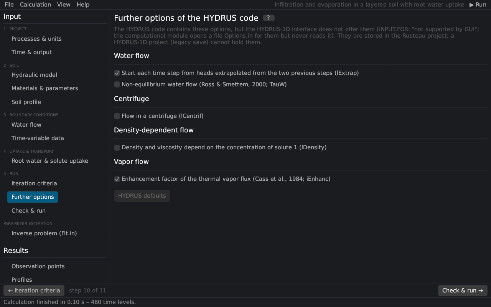

# Further options of the HYDRUS code
keywords: further options; Options.in; extrapolation; non-equilibrium water flow; TauW; centrifuge; density-dependent flow; enhancement factor; lExtrap; iEnhanc; lCentrif; lDensity

The HYDRUS-1D code contains options that its interface does not offer (INPUT.FOR: "New Options – Not supported by GUI"). The computational module opens a file `Options.in` for them but never reads it, so HYDRUS-1D always runs with the defaults. Rusteau offers them on this page and stores them in the project; a HYDRUS-1D project cannot hold them. *HYDRUS defaults* resets them.

## Water flow

| Option | Description |
|---|---|
| Extrapolation of the heads (lExtrap, default on) | each time step starts from heads extrapolated linearly from the two previous steps; off: from the heads of the previous step |
| Non-equilibrium water flow (TauW) | the water content approaches the equilibrium water content of the pressure head with the time constant τw [@rossSmettem2000] ([theory](th_advanced_options#nonequilibrium)) |

## Centrifuge (lCentrif)

Flow in a centrifuge: the gravity term becomes ω²(R + depth)/g with the rotation speed [rpm] and the distance R of the soil surface from the axis ([theory](th_advanced_options#centrifuge)). With a time-variable bottom boundary condition the hBot column gives the speed and the bottom pressure head is 0, as in HYDRUS.

## Density-dependent flow (lDensity)

The density and the viscosity of the solution are cubic polynomials of the liquid concentration of solute 1: ρ/ρ0 = a0 + a1 c + a2 c² + a3 c³ (HYDRUS: 1 + 0.75 c) and μ/μ0 likewise (HYDRUS: 1). The conductivity scales with ρ/μ, the gravity term and the storage with ρ ([theory](th_advanced_options#density)).

## Vapor flow

| Option | Description |
|---|---|
| Enhancement factor of the thermal vapor flux (iEnhanc, default on) | the thermal vapor flux is multiplied by the enhancement factor of [@cass1984]; off: factor 1 ([vapor flow](th_vapor)) |

> Non-equilibrium water flow, the centrifuge and density-dependent flow are not available with the dual-permeability model.
