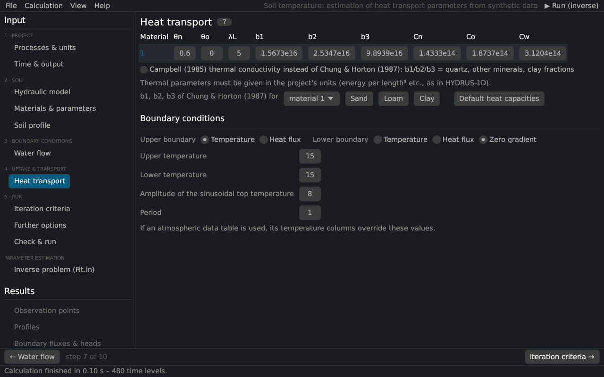

# Heat transport
keywords: heat transport parameters; thermal conductivity; heat capacity; Chung Horton; Campbell; thermal dispersivity; temperature boundary conditions

The page holds the *Heat Transport Parameters* and *Heat Transport Boundary Conditions* of HYDRUS-1D. The equations are in [heat transport](th_heat).

## Parameters per material

| Parameter | Description |
|---|---|
| θn | volume fraction of the solid phase [–] (≈ 1 − porosity) |
| θo | volume fraction of organic matter [–] |
| λL | longitudinal thermal dispersivity [L] |
| b1, b2, b3 | coefficients of the thermal conductivity λ0(θ) = b1 + b2 θ + b3 θ^{0.5} [@chungHorton1987] |
| Cn, Co, Cw | volumetric heat capacities of the solid phase, organic matter and water [@deVries1963] |

The thermal parameters are in the project's units with the mass in kg ([units](units#heat)). The buttons enter typical values converted to the project's units:

| Button | Values |
|---|---|
| b1, b2, b3 for sand / loam / clay | [@chungHorton1987]: sand 0.228, −2.406, 4.909; loam 0.243, 0.393, 1.534; clay −0.197, −0.962, 2.521 W/m/K |
| Default heat capacities | Cn = 1.92, Co = 2.51, Cw = 4.18 MJ/m³/K |

*Campbell (1985) thermal conductivity* uses the function of [@campbell1985] instead; b1, b2 and b3 then hold the volume fractions of quartz, other minerals and clay.

## Boundary conditions

| Input | Description |
|---|---|
| Upper boundary | temperature (first type) or heat flux (third type: the heat carried by the entering water) |
| Lower boundary | temperature, heat flux or zero gradient |
| Upper / lower temperature | [°C]; overridden by the Ttop / Tbot columns of the time-variable data |
| Amplitude, period | sinusoidal daily variation of the surface temperature, T(t) = Ttop + A sin(2π t / p − 7π/12) with the amplitude A and the period p; the maximum is reached at 13:00 for p = 1 d |

With the [surface energy balance](th_energy_balance) the surface temperature follows from the energy balance instead.

The initial temperatures are set on the page [Soil profile](profile_editor).
