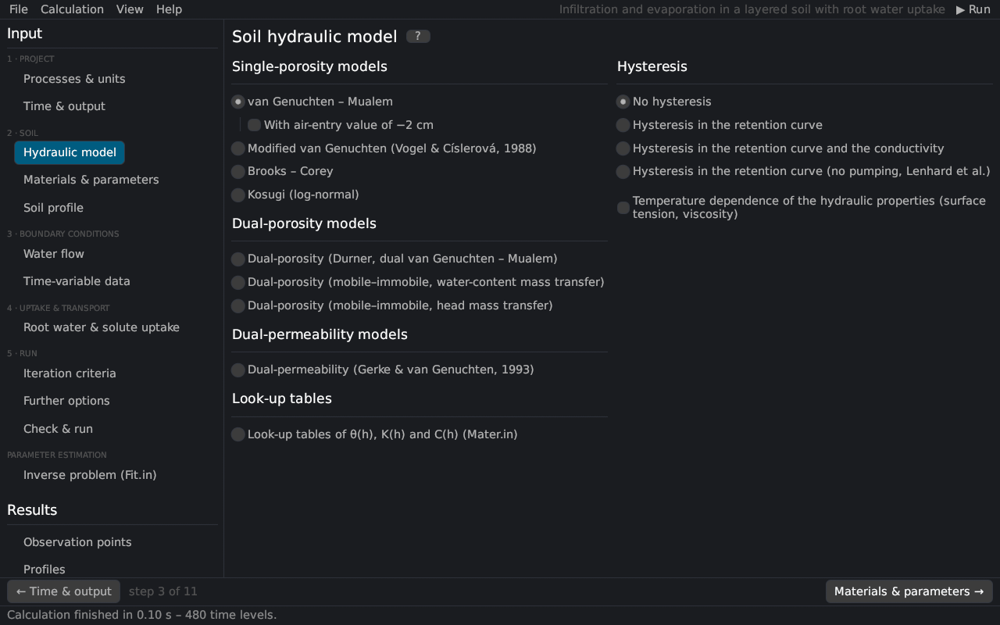

# Soil hydraulic model
keywords: soil hydraulic model; hysteresis; van Genuchten; Brooks Corey; Kosugi; Durner; dual porosity; dual permeability; look-up tables; Hysteresis.in; restart; temperature dependence

The page follows the *Soil Hydraulic Model* dialog of HYDRUS-1D 4.17: the model of the soil hydraulic properties on the left, hysteresis on the right.

## Hydraulic models

| Model | Description |
|---|---|
| van Genuchten – Mualem | The standard model [@vanGenuchten1980; @mualem1976]. With *air-entry value of −2 cm* the retention curve starts at hs = −2 cm, which improves the conductivity near saturation for fine soils with n close to 1 [@vogel2001; @schaapVG2006]. |
| Modified van Genuchten | Extra flexibility near saturation with θm, θa, θk and Kk [@vogelCislerova1988]. |
| Brooks – Corey | Retention with a sharp air-entry value [@brooksCorey1964]. |
| Kosugi (log-normal) | Log-normal pore-size distribution [@kosugi1996]. |
| Dual-porosity (Durner) | Bimodal retention curve as the sum of two van Genuchten curves [@durner1994]; one flow equation. |
| Dual-porosity (mobile–immobile), water-content or head mass transfer | Flow in the mobile region with exchange to an immobile region [@simunek2003]; see [dual-porosity models](th_dual_porosity). |
| Dual-permeability | Two flowing domains, fractures and matrix [@gerkeVG1993a]; see [dual permeability](th_dual_permeability) and below. |
| Look-up tables | θ(h), K(h) and C(h) from tables (`Mater.in` of a HYDRUS-1D project). |

The equations are given in [soil hydraulic property models](th_hydraulic_models); the parameters are entered on the page [Materials & parameters](soil_params).

## Hysteresis {#hysteresis}

| Option | Description |
|---|---|
| No hysteresis | One retention curve (main drying curve). |
| Hysteresis in the retention curve | Scanning curves between the main drying and the main wetting curve after [@koolParker1987]; extra parameters θm, θs,w and αw. |
| Hysteresis in the retention curve and the conductivity | Also K(h) is hysteretic; extra parameter Ks,w. |
| Hysteresis in the retention curve (no pumping, Lenhard et al.) | Model that keeps track of the reversal points and avoids the drift of scanning loops ("pumping") [@lenhard1991; @lenhardParker1992]. |
| Initially drying / wetting curve | Branch of the initial condition (iKappa = −1 / +1). |

See [hysteresis](th_hysteresis) for the equations.

## Initial hysteresis state (Hysteresis.in) {#restart}

With Kool–Parker hysteresis the state of a soil is more than its pressure heads: each node lies on a scanning curve that depends on its history. The state can be taken from a previous run: *Soil profile → Initial h → Restart from these results* sets the heads and the hysteresis state (water contents, branches and conductivities) of all nodes at a print time. HYDRUS reads this state from the file `Hysteresis.in`, which Rusteau reads and writes with HYDRUS-1D projects. The page shows how many nodes are on a wetting or drying branch; *Clear* returns to the main curve chosen above. The state is dropped when the profile gets new nodes.

## Temperature dependence

*Temperature dependence of the hydraulic properties* scales the pressure head with the surface tension and the conductivity with the viscosity and density of water at the soil temperature [@constantz1982; @philipDeVries1957]; it requires heat transport ([temperature dependence](th_hydraulic_models#temperature)).

## Dual-permeability parameters {#dualperm}

With the dual-permeability model the page shows the parameters of the fracture–matrix interface (they are not stored in HYDRUS-1D projects):

| Input | Description |
|---|---|
| Fracture volume fraction w | Volume of the fracture domain relative to the soil, the same for all layers. |
| Distribute boundary fluxes … (f = w) | Prescribed boundary fluxes are split in proportion to the volumes; otherwise give the fraction entering the fractures. |
| Dual porosity inside the matrix | Mobile and immobile matrix water with water-content (ωw) or pressure-head driven transfer. |
| β | Shape factor of the matrix blocks (3 for slabs) [@gerkeVG1996]. |
| γw | Scaling coefficient of the water transfer, 0.4 [@gerkeVG1993b]. |
| a | Effective diffusion path length (half width of the blocks) [L]. |
| Kas | Saturated conductivity of the interface; 0 = matrix Ks. |
| l (matrix) | Pore connectivity of the matrix. |
| θr, θs, α, n immobile, Ks interface, ωw | Parameters of the immobile matrix region. |

On the page *Materials & parameters* the primary columns then describe the fracture domain and the extra columns θr,m, θs,m, α_m, n_m, Ks,m the matrix.
