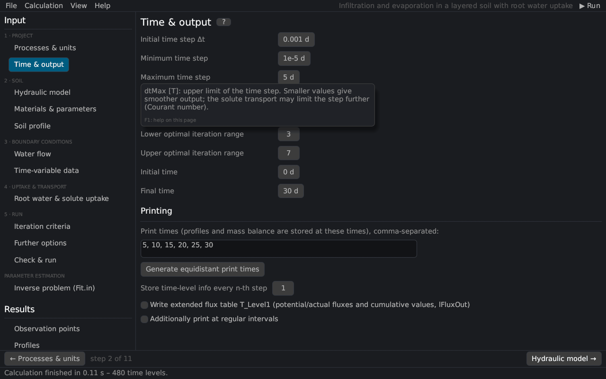
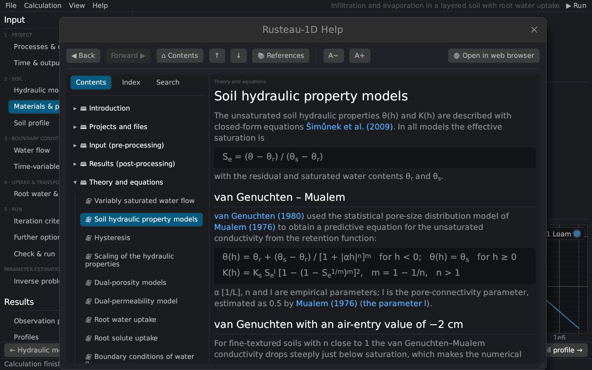

# The main window
keywords: main window; menu; navigation; status bar; workflow bar; themes; tooltips; drag and drop

## Menu bar {#menu}

| Menu | Commands |
|---|---|
| **File** | *New project* (Ctrl+N), *Examples*, *Open project* (Ctrl+O, `.h1dr` or a HYDRUS-1D `.h1d`), *Import HYDRUS-1D project folder…*, *Import optimization file (Fit.in)…*, *Save* (Ctrl+S), *Save as…* (Ctrl+Shift+S), *Save as HYDRUS-1D project*, the option *Save also writes a HYDRUS-1D project*, *Export results (CSV)…*, *Quit* – see [Projects and files](projects) |
| **Calculation** | *▶ Run* (F5) and *■ Stop* |
| **View** | *Figures (new window)…* – the [figure editor](figures); dark and light theme |
| **Help** | help on the current page (F1), contents, getting started, theory, references, the help in the web browser, export of the HTML help, keyboard and mouse, about |

At the right end of the menu bar are the project title (with `*` when there are unsaved changes) and the **▶ Run** button (**▶ Run (inverse)** for a parameter estimation, **■ Stop** while a calculation runs).

## Navigation panel {#navigation}

The left panel lists the **input pages** in the steps of a project ([workflow](workflow)):

1. **Project**: Processes & units, Time & output
2. **Soil**: Hydraulic model, Materials & parameters, Soil profile
3. **Boundary conditions**: Water flow, Time-variable data (with time-variable or atmospheric conditions), Meteorological data (with meteorological ET)
4. **Uptake & transport**: Root water & solute uptake, Heat transport, the five solute pages – each shown only when the process is switched on
5. **Run**: Iteration criteria, Further options, Check & run

and **Parameter estimation** with the page *Inverse problem (Fit.in)*. Below follow the **results pages**; they are enabled after a run (the soil hydraulic properties can be viewed at any time). The last entry, **📈 Figures**, opens the [figure editor](figures) in a window of its own (with the number of figures of the project).

## Pages

Every page has a title with a **?** button that opens its help topic (as F1). Inputs show a **tooltip** with their meaning, unit and typical values when the mouse rests on the label or the value:

Number fields accept typing (click, type, Enter) and dragging with the mouse; a comma is accepted as decimal separator and `d` / `D` as exponent (`1d-3`, as in Fortran files). While a number is typed, other characters (letters, blanks, units) are ignored; whole-number fields (numbers of nodes, solutes, iterations …) accept only digits and the minus sign. A value that is still not a number when the field is left (e.g. `1e`) is discarded and the field keeps its previous value. Changes mark the project as modified.

## Workflow bar and status bar {#bars}

On the input pages a bar at the bottom leads to the previous and the next page of the workflow (*step k of n*); on the last page it runs the calculation. The status bar shows messages (files written, problems, the end of a run) and, during a run, a progress bar with the current time.

## Help window {#help-window}

The help window has a table of contents, a keyword index and a full-text search, back and forward buttons (Alt+← / Alt+→), buttons for a larger or smaller text, and *Open in web browser*, which writes the help as HTML pages and opens the current topic in the browser.

## Drag and drop

Dropping a `.h1dr` file, a HYDRUS-1D `.h1d` file or a HYDRUS-1D project folder (or any file in it) onto the window opens it; while dragging, the window shows what the drop would do.

## Themes

*View → Dark theme / Light theme* switches the colours. Plots are meant for inspection; for figures use the CSV output.
