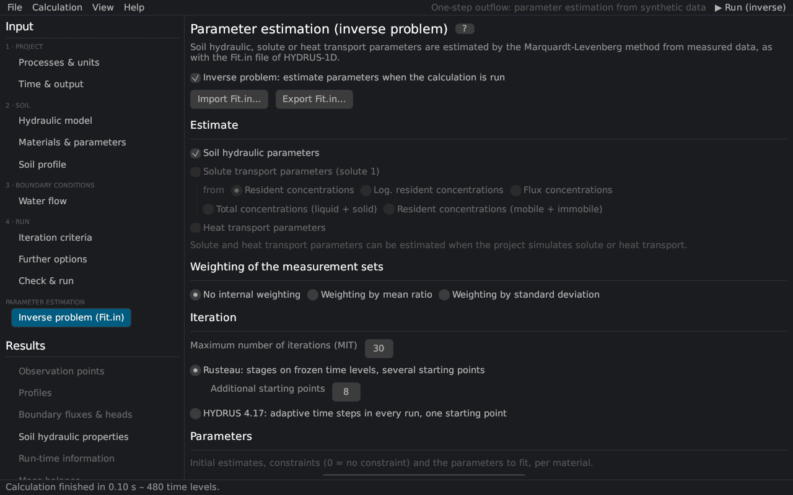

# Parameter estimation (inverse problem)
keywords: inverse problem; parameter estimation; Fit.in; optimization; observations; objective function; weighting; Marquardt; initial estimates; constraints; data types

On this page the parameter estimation is set up: which parameters to estimate, their initial estimates and constraints, the measured data (observations) and the iteration. It corresponds to the *Inverse Solution*, *Soil Hydraulic Parameters – Inverse* and *Data for Inverse Solution* dialogs of HYDRUS-1D and the file `Fit.in`. The method is described in [parameter estimation](th_inverse).

Switch on *Inverse problem* and create the settings from the current project, or import a `Fit.in`. *Export Fit.in…* writes the settings for HYDRUS-1D.

## Estimate

| Group | Description |
|---|---|
| Soil hydraulic parameters | θr, θs, α, n, Ks, l and the extra parameters of the model; with hysteresis also θm, θs,w, αw, Ks,w with the optional constraints (θm = θs, αw = 2α, Ksw = Ks) |
| Solute transport parameters | of solute 1: bulk density, dispersivity, f, θim, diffusion, sorption, decay, rate coefficients; with the type of concentration of the objective function (resident, logarithm, flux, total, mobile + immobile) |
| Heat transport parameters | θn, θo, λL, b1–b3, Cn, Co, Cw (HYDRUS 4.17; temperatures are observations of type 4) |

Solute and heat parameters exclude each other, as in HYDRUS 4.17.

## Weighting of the measurement sets

The measurement sets are the observation types. *No internal weighting*: all sets weight 1. *By mean ratio*: each set is weighted by the ratio of the smallest mean of all sets to its own mean. *By standard deviation*: 1/(√n σ) of the set ([objective function](th_inverse#objective)).

## Iteration

| Input | Description |
|---|---|
| Maximum number of iterations (MIT) | 0 = a direct run with the initial estimates |
| Rusteau iteration (default) | stages on frozen time levels and further starting points; the number of additional starting points (8) runs in parallel threads ([theory](th_inverse#rusteau)) |
| HYDRUS 4.17 iteration | adaptive time steps in every run, one starting point – for comparisons with HYDRUS |

## Parameters

For every material and group: the initial estimate, the minimum and maximum (0 = no constraint) and *Fitted?*. *Take the initial estimates from the project* copies the material parameters; the soil catalog [@carselParrish1988] and *Rosetta…* [@schaap2001] give initial estimates of the hydraulic parameters. Constraints that bound the physically sensible range help the estimation, especially with several starting points.

## Observations {#observations}

| Column | Description |
|---|---|
| Type | 0 cumulative boundary flux, 1 pressure head at an observation node, 2 water content at an observation node (position 0: mean of the profile, −k: of sub-region k), 3 boundary flux, 4 concentration (or temperature with heat parameters) at an observation node (position 0: solute mass in the profile), 5 retention point θ(h), 6 conductivity K(h), 7–11 prior information on α, n, θr, θs, Ks, 12–15 h, θ, c or sorbed c against depth at a print time |
| Position | the observation node, the boundary (1 top, 2 bottom), the material or the print time, depending on the type |
| Time / h / x | time (types 0–4), pressure head (5, 6) or depth (12–15) |
| Value, Weight | the observed value and its weight |

*+ Add observation* adds a row, *Paste observations* appends lines `x value type position weight` from the clipboard (as in `Fit.in`), *Remove all* clears the table. A summary shows the number of observations per type.

*▶ Run parameter estimation* starts the estimation; the [results page](res_inverse) shows the iterations live.
