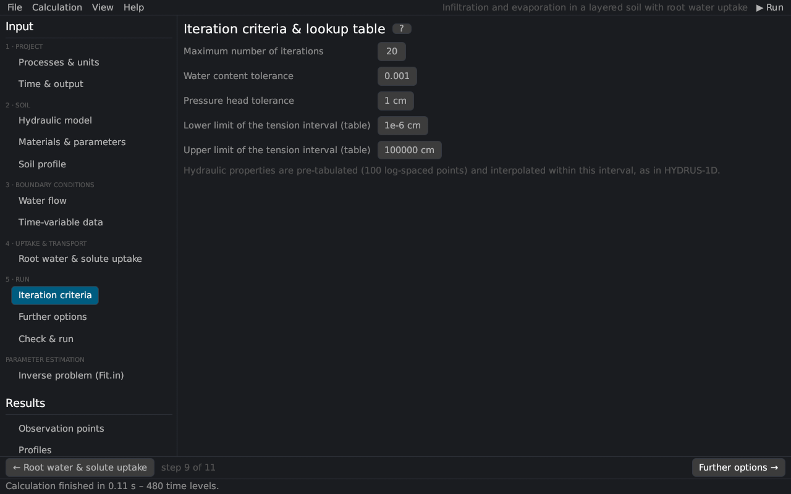

# Iteration criteria
keywords: iteration criteria; tolerance; water content tolerance; pressure head tolerance; maximum number of iterations; interpolation tables; hTab; convergence

The page corresponds to the *Iteration Criteria* dialog of HYDRUS-1D. The time-step control of the same dialog is on the page [Time & output](time_output).

Because of the non-linearity of the Richards equation, every time step is solved iteratively ([numerical solution](th_numerics)). The first estimate of the pressure heads at a new time step is extrapolated from the two previous time levels. The iteration continues until, at all nodes in the unsaturated (saturated) part of the profile, the absolute change of the water content (pressure head) between two successive iterations is smaller than the tolerance.

| Input | HYDRUS | Description |
|---|---|---|
| Maximum number of iterations | MaxIt | iterations allowed in a time step (default 10); when exceeded, the step is repeated with Δt/3 |
| Water content tolerance | TolTh | absolute tolerance for unsaturated nodes [–] (default 0.001) |
| Pressure head tolerance | TolH | absolute tolerance for saturated nodes [L] (default 1 cm) |
| Lower / upper limit of the tension interval | hTab1, hTabN | absolute pressure heads [L] of the internal interpolation tables of θ(h), K(h) and C(h) (100 log-spaced points); outside the interval the functions are evaluated directly |

> We do not recommend changing the default values unless you know what you are doing (as the HYDRUS-1D help says). Tighter tolerances (e.g. TolTh = 0.0001, TolH = 0.1 cm) make the results more precise and the run slower; looser ones may give mass balance errors.

## Internal interpolation tables {#tables}

The hydraulic functions are evaluated many times per time step. As in HYDRUS-1D, they are tabulated once for each material at 100 logarithmically spaced pressure heads between hTab1 and hTabN and interpolated linearly in log |h| [@vogel1987]. The interval should cover the heads of the simulation; with very dry conditions (e.g. evaporation down to hCritA = 10⁶ cm) raise hTabN.

See also: [numerical solution](th_numerics) · [questions and problems](faq#convergence)
