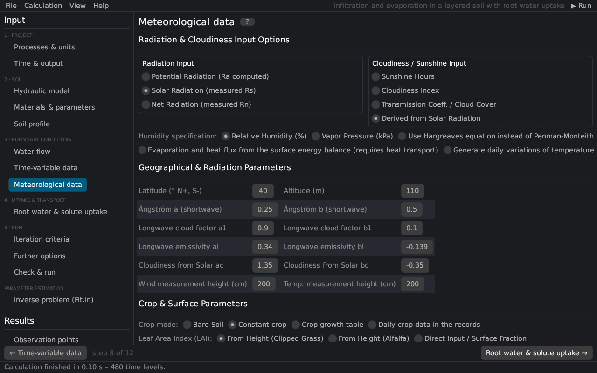

# Meteorological data
keywords: meteorological data; METEO.IN; Penman-Monteith; Hargreaves; radiation; sunshine; humidity; wind; crop; LAI; albedo; energy balance; latitude; altitude

With *Meteorological ET* switched on ([Processes & units](processes)), the potential evaporation and transpiration are computed from meteorological records with the Penman–Monteith combination equation [@monteith1981; @allen1998] or the Hargreaves equation [@hargreavesSamani1985], or the evaporation follows from the surface energy balance [@saito2006]. The page corresponds to the *Meteorological Parameters* and *Meteorological Conditions* dialogs of HYDRUS-1D (file `METEO.IN`).

## Radiation and cloudiness

| Option | Description |
|---|---|
| Potential radiation | No radiation data: the solar radiation is estimated with the Ångström formula Rs = (as + bs n/N) Ra [@angstrom1924]. |
| Solar radiation | Measured global radiation Rs [MJ/m²/d]. |
| Net radiation | Measured net radiation Rn [MJ/m²/d]. |
| Sunshine hours / cloudiness index / transmission coefficient / derived from solar radiation | What the last column of the records holds and how the cloudiness factor of the long-wave radiation is obtained. |
| Relative humidity / vapor pressure | What the humidity column holds. |
| Hargreaves | Use the Hargreaves equation instead of Penman–Monteith ([theory](th_hargreaves)). |
| Energy balance | Evaporation and soil heat flux from the surface energy balance (requires heat transport; [theory](th_energy_balance)). |
| Daily variations | Hourly air temperatures and humidities generated from the daily records; the time step is limited to one hour. |

## Geographical and radiation parameters

| Parameter | Description |
|---|---|
| Latitude, altitude | location of the site (extraterrestrial radiation, day length, atmospheric pressure) |
| Ångström a, b | as = 0.25, bs = 0.50 (FAO-56) [@allen1998] |
| Long-wave cloud factors a1, b1 | f = a1 n/N + b1 (0.9, 0.1) [@doorenbosPruitt1977] |
| Long-wave emissivity al, bl | net emissivity ε = al + bl √ea (0.34, −0.14) |
| Cloudiness from solar radiation ac, bc | f = ac Rs/Rso + bc (1.35, −0.35) |
| Wind and temperature measurement heights | [cm]; must exceed the zero-plane displacement 0.67 × crop height |

## Crop

| Option | Description |
|---|---|
| Bare soil | evaporation only |
| Constant crop | crop height, albedo, LAI (and root depth) constant |
| Crop growth table | values interpolated from a table of times |
| Daily crop data in the records | every record carries crop height, albedo, LAI and root depth |
| LAI from height (clipped grass / alfalfa) or direct input | leaf area index from the crop height [@allen1998] or given directly (a value below 1 is read as the soil cover fraction) |
| Radiation extinction coefficient | k for the partitioning of ETp into evaporation and transpiration [@ritchie1972] |
| Canopy interception | interception constant a [mm] [@vonHoyningenHune1983; @braden1985] |

## Records

Each record gives the time t [T], radiation [MJ/m²/d], maximum and minimum air temperature [°C], mean relative humidity [%] or vapor pressure [kPa], wind speed [km/d] and sunshine hours (or cloudiness, transmission coefficient), and optionally the crop data. The meteorological inputs are in these fixed units whatever the project's units are ([units](units#conversion)).

See also: [Penman–Monteith equation](th_penman) · [Hargreaves equation](th_hargreaves) · [surface energy balance](th_energy_balance) · [atmospheric inputs](th_atmosphere)
