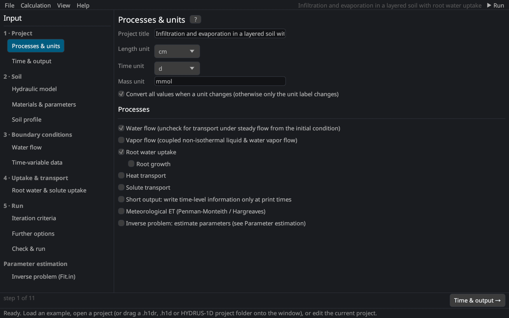

# Processes & units
keywords: main processes; units; project title; water flow; vapor flow; heat transport; solute transport; root water uptake; root growth; inverse problem; meteorological data

The first page of a project (the *Main Processes* and *Units* dialogs of HYDRUS-1D) sets the title, the units and the processes to simulate. Pages of processes that are switched off are hidden in the navigation.

## Project and units

| Input | Description |
|---|---|
| Project title | Name of the project, written to the HYDRUS-1D files. |
| Length unit | mm, cm or m – the unit of heads, depths and lengths. |
| Time unit | seconds, minutes, hours, days or years. |
| Mass unit | label of the concentrations [M/L³]; masses are not converted. |
| Convert all values when a unit changes | rescales every input when the length or time unit changes ([units](units#conversion)); off: only the label changes. |

## Processes

| Process | Description |
|---|---|
| Water flow | Variably saturated water flow ([Richards equation](th_richards)). Off: the water contents and fluxes of the initial condition stay constant, e.g. for heat or solute transport in a steady flow field. |
| Vapor flow | Coupled liquid water, water vapor and heat flow [@saito2006] ([vapor flow](th_vapor)); requires heat transport. |
| Root water uptake | Sink term of [root water uptake](th_root_uptake); enables the page *Root water & solute uptake* and the root distribution in the soil profile. |
| Root growth | Time-variable rooting depth ([root growth](th_root_uptake#growth)). Only with root water uptake: switching uptake off switches root growth off too. |
| Heat transport | [Heat transport](th_heat) by conduction and convection. |
| Solute transport | [Solute transport](th_solute) with the number of solutes (1–11). |
| Short output | Writes the time-level tables only at the print times (lShort). |
| Meteorological ET | Potential evapotranspiration from meteorological data with [Penman–Monteith](th_penman) or [Hargreaves](th_hargreaves), or the [surface energy balance](th_energy_balance); enables the page *Meteorological data*. |
| Inverse problem | [Parameter estimation](th_inverse) from measured data; settings on the page [Inverse problem (Fit.in)](inverse_page). |

> With vapor flow the results depend slightly on the length unit, as in HYDRUS ([vapor flow](th_vapor)).

## Related topics

[Time & output](time_output) · [Workflow](workflow) · [Units](units)
