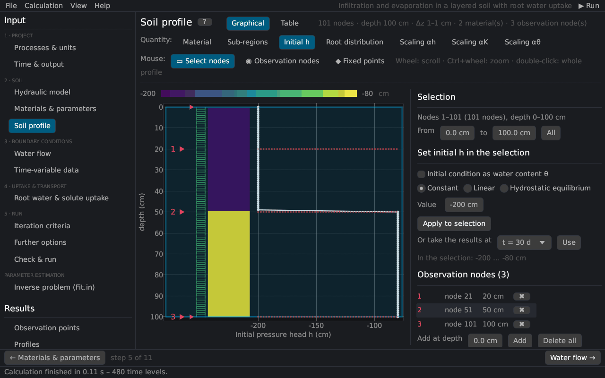
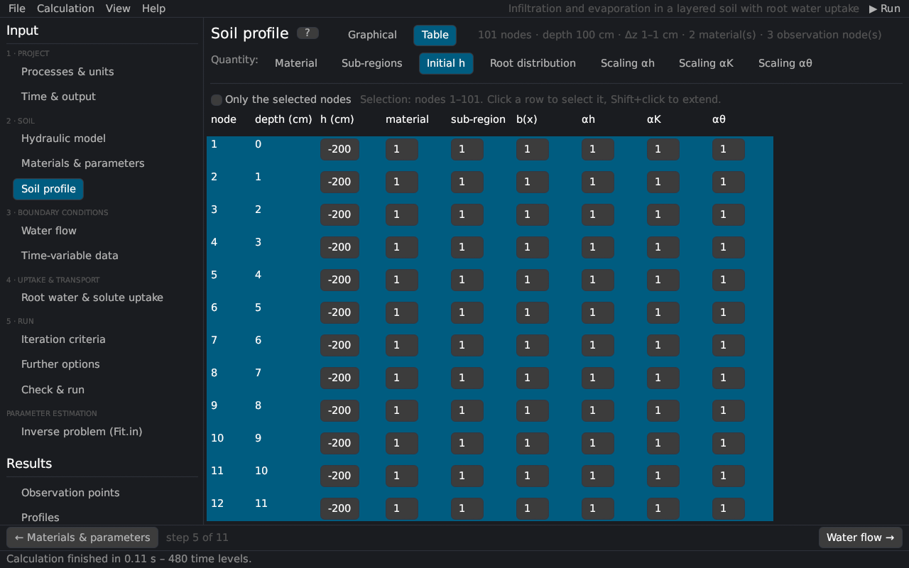

# Soil profile
keywords: soil profile; profile editor; nodes; discretization; fixed points; initial condition; observation nodes; root distribution; scaling factors; sub-regions; materials; hydrostatic equilibrium; PROFILE.DAT

The soil profile editor sets the finite element mesh and all nodal values: materials, sub-regions of the mass balance, the initial condition (pressure head or water content), the root distribution, the scaling factors, temperatures and concentrations, observation nodes and fixed points. It replaces the *Profile* module (PROFILE.DAT) of HYDRUS-1D.

## Views

- **Graphical**: the selected quantity is drawn as a coloured column next to its curve; nodes, observation nodes (◉) and fixed points (◆) are marked.
- **Table**: all nodal values; a click selects a node, Shift+click extends the selection; *Only the selected nodes* shortens the table.

The header line shows the number of nodes, the depth, the smallest and largest element and the numbers of materials and observation nodes.

## Quantities

| Quantity | Description |
|---|---|
| Material | Material number of the node ([Materials & parameters](soil_params)). |
| Sub-regions | Regions of the mass balance (Balance); they do not change the simulation. *Sub-regions = materials* gives one region per material. |
| Initial h / Initial θ | Initial pressure head [L] or, with *Initial condition as water content θ*, the initial water content. |
| Root distribution | Relative root density b(x) [–] (with root water uptake); normalized by the program ([root distribution](th_root_uptake#distribution)). |
| Scaling αh, αK, αθ | Scaling factors of the pressure head, the conductivity and the water content ([scaling](th_scaling)); 1 = no scaling. |
| Temperature | Initial temperature [°C] (heat transport or temperature-dependent solute parameters). |
| Conc. k / Non-eq. conc. k | Initial liquid concentration of solute k [M/L³] and the initial sorbed (kinetic sites) or immobile concentration. |

## Selecting nodes

With the mouse tool *Select nodes*: drag a depth range; a click selects one node (for material and sub-region a whole layer); Shift+click extends the selection; Ctrl+A selects all. Or enter the depths *From … to …*. Mouse wheel: scroll; Ctrl+wheel: zoom; double-click: whole profile.

## Setting values in the selection

| Distribution | Description |
|---|---|
| Constant | the same value at all selected nodes |
| Linear | linear between the values at the top and the bottom of the selection |
| Hydrostatic equilibrium | h = h(bottom) − (z(bottom) − z)·cos α from the lowest selected node (initial pressure head): no flow at the start |
| Hoffman & van Genuchten (1983) | root distribution constant in the upper 20 % of the rooting depth Lr, linear to zero at Lr [@hoffmanVG1983] |
| Vrugt et al. (2001) | b(z) = (1 − z/zm) exp(−p/zm · \|z\* − z\|) with the maximum rooting depth zm, the depth of maximum intensity z\* and p = pz above z\* (p = 1 below) [@vrugt2001] |

*Apply to selection* sets the values. With results of a previous run, *Or take the results at t = …* sets the initial pressure head (or water content), temperature or concentrations from any print time (interpolated in depth). With Kool–Parker hysteresis, *Restart from these results* also takes the hysteresis state of all nodes ([restart](hyd_model#restart)).

## Observation nodes {#observation}

Observation nodes record h, θ, temperature, flux and concentrations at every time step ([Observation points](res_obs)). With the mouse tool *Observation nodes* a click in the profile adds an observation node at the nearest node, or selects the observation node under the pointer (it is drawn larger); dragging moves it to another node, a double-click or the Delete key removes it. The list on the right shows every observation node with its node number and depth: select one, drag or type its node number or depth (a depth moves it to the nearest node; nodes that are already observation nodes are skipped), *✖* removes one. *Add at depth* adds one at a typed depth, *Delete all* removes all (at most 100).

## Profile depth and discretization {#discretization}

| Input | Description |
|---|---|
| Profile depth | depth of the profile [L] |
| Number of nodes | 2–1001 |
| Fixed points | depths that are always nodes, with the relative size of the elements above and below each point; the surface and the bottom are always fixed points |

*Fixed points at material boundaries* adds a fixed point at every change of material; *Uniform* sets all relative sizes to 1. With relative sizes, the nodes are denser where the size is small, e.g. 0.1 at the surface and 1 at the bottom for a fine mesh near the surface. *Generate nodes* creates the new nodes and interpolates all nodal values onto them (observation nodes keep their depth); *Discard* drops the changes. Fixed points are stored in the header of `PROFILE.DAT`, as in HYDRUS-1D.

See [notes on spatial and temporal discretization](th_discretization) for the choice of the element sizes.

## Inclination

*cos α* is the cosine of the angle between the flow direction and the vertical (1 = vertical flow, 0 = horizontal flow) ([Richards equation](th_richards)).
