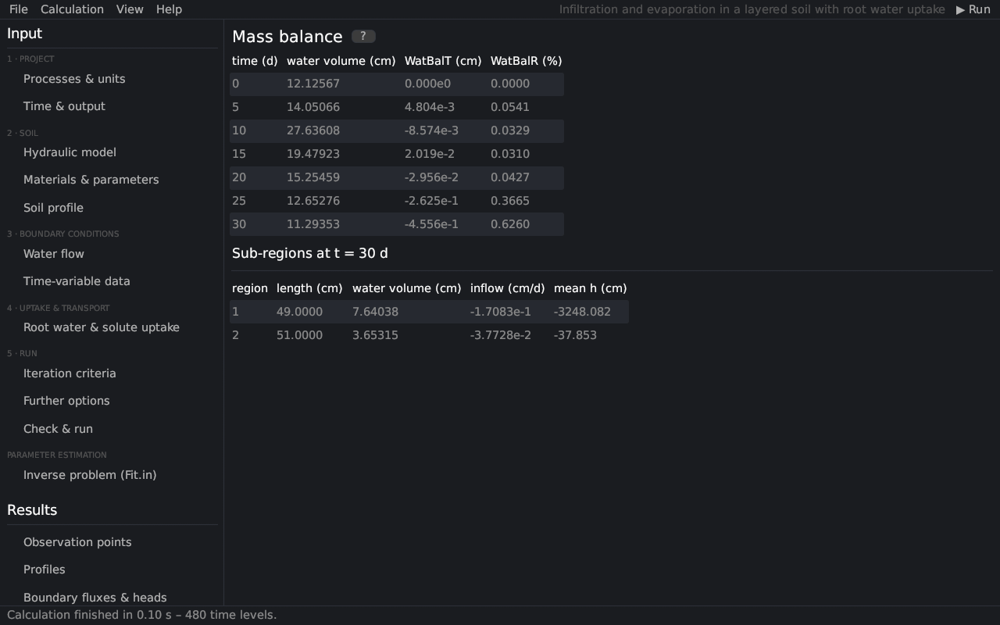

# Mass balance
keywords: mass balance; water balance; balance error; WatBalT; WatBalR; sub-regions; solute mass balance; Balance.out

The page lists the water and solute balance at the print times, as *Mass Balance Information* in HYDRUS-1D (file `Balance.out`, here `BALANCE.csv`).

## Columns

| Column | Meaning |
|---|---|
| time | print time |
| water volume | water in the profile per unit area [L] |
| WatBalT | absolute error of the water balance [L] |
| WatBalR | relative error of the water balance [%] |
| mass k | mass of solute k in the profile [M/L²] |
| CncBalT k, CncBalR k | absolute and relative error of the solute balance |

The absolute error is the difference between the change of the water volume since the start and the cumulative boundary fluxes and sink terms:

$$ ε_{a}^{w} = V_{t} − V_{0} + ∫_{0}^{t} T_{a} dt − ∫_{0}^{t} (q_{0} − q_{N}) dt $$

with the volumes V of the profile, the actual transpiration T_{a} and the fluxes q_{0}, q_{N} across the bottom and the surface [@simunek2009]. The relative error relates it to the larger of the absolute change of the volume and the cumulative fluxes:

$$ ε_{r}^{w} = 100 \|ε_{a}^{w}\| / max(Σ\|ΔV_{i}\|, ∫ \|T_{a}\| dt + ∫ \|q_{0}\| dt + ∫ \|q_{N}\| dt) $$

A well-posed problem usually has a relative error below about 1 %. Larger errors call for a smaller maximum time step, tighter [iteration criteria](iteration) or a finer mesh near the surface or at material interfaces ([discretization](th_discretization)).

## Sub-regions

At the last print time the table lists every sub-region (set on the page [Soil profile](profile_editor)): its length, water volume, inflow (rate of change of the volume), mean pressure head and the mass and mean concentration of each solute.
