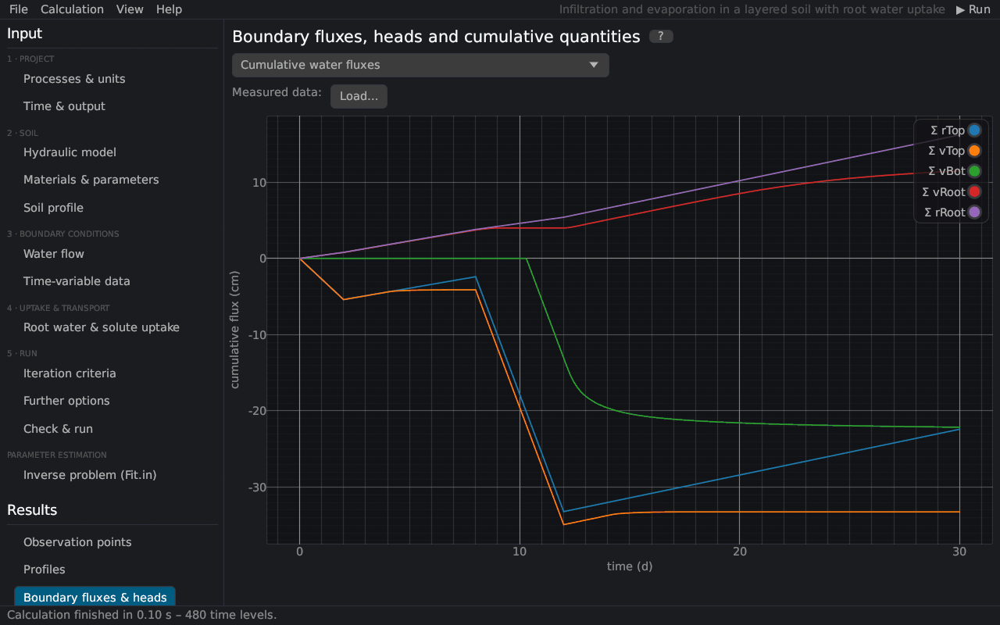

# Boundary fluxes, heads and cumulative quantities
keywords: boundary information; water fluxes; cumulative fluxes; actual evaporation; actual transpiration; runoff; infiltration; T_Level; solute fluxes

The page shows the time-level information against time, as *Water Flow – Boundary Fluxes and Heads* and *Solute Transport – Boundary Fluxes* in HYDRUS-1D (file `T_Level.out`, here `T_LEVEL.csv`).

| Group | Curves |
|---|---|
| Water fluxes | rTop (potential surface flux), vTop (actual surface flux), vBot (bottom flux), vRoot (actual transpiration) [L/T] |
| Cumulative water fluxes | the cumulative values of the potential and actual fluxes [L] |
| Pressure heads | at the surface, mean of the root zone, at the bottom [L] |
| Surface | runoff and the cumulative infiltration and evaporation |
| Soil water storage | water volume of the profile [L] |
| Temperature | at the top and the bottom node |
| Solute k | boundary fluxes, cumulative fluxes, concentrations at the top and the bottom |

**Signs** follow HYDRUS: fluxes are positive upward. At the surface, negative values are infiltration and positive values evaporation; at the bottom, negative values leave the profile (drainage). The difference between the potential (rTop, rRoot) and the actual fluxes (vTop, vRoot) shows the limitation by the soil: evaporation limited by hCritA, infiltration limited by the infiltration capacity (ponding, runoff), transpiration reduced by water or osmotic stress.

*Measured data*: *Load…* adds measured values (time, value) to the chosen group ([measured data](measured_data)).
