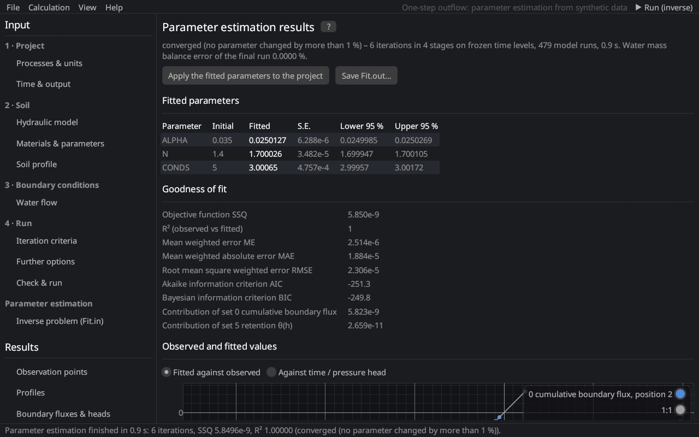

# Parameter estimation results
keywords: inverse results; Fit.out; fitted parameters; confidence intervals; standard error; correlation matrix; goodness of fit; R2; AIC; BIC; iterations; starting points

The page shows the run and the results of a parameter estimation, the content of `Fit.out` of HYDRUS-1D (*Inverse Solution Information*).

## During the run

The iteration table of the first starting point is filled live (iteration, objective function SSQ, parameter values), and the finished starting points are listed. *■ Stop* ends the estimation.

## Results

| Section | Content |
|---|---|
| Fitted parameters | initial estimate, fitted value, standard error (S.E.) and the 95 % confidence interval of every fitted parameter [@simunekHopmans2002] |
| Goodness of fit | SSQ, R² of observed against fitted values, mean error ME, mean absolute error MAE, RMSE, AIC [@akaike1974], BIC [@schwarz1978] and the contribution of every measurement set to SSQ |
| Observed and fitted values | fitted against observed values with the 1:1 line, or observed (points) and fitted (line) values of one measurement set against time, pressure head or depth |
| Correlation matrix | correlations between the fitted parameters; \|r\| > 0.95 is highlighted (the data cannot separate these parameters) |
| Starting points | the further starting points with their initial values, final SSQ, iterations and why they stopped; the result of the lowest SSQ is shown |
| Iterations | SSQ and the parameters of every iteration |

*Apply the fitted parameters to the project* writes the fitted values into the materials and makes them the initial estimates of a new estimation. *Save Fit.out…* writes the results in the layout of HYDRUS-1D 4.17. The results of the final run with the fitted parameters fill the other results pages.

## Interpreting the results

- Wide confidence intervals or high correlations mean that the data do not determine the parameters well: fit fewer parameters, add different kinds of data (e.g. retention points to outflow data) or use constraints.
- Compare the objective functions of the starting points: if they end at different SSQ values, the objective function has several local minima.

See [parameter estimation (theory)](th_inverse) for the definitions.
