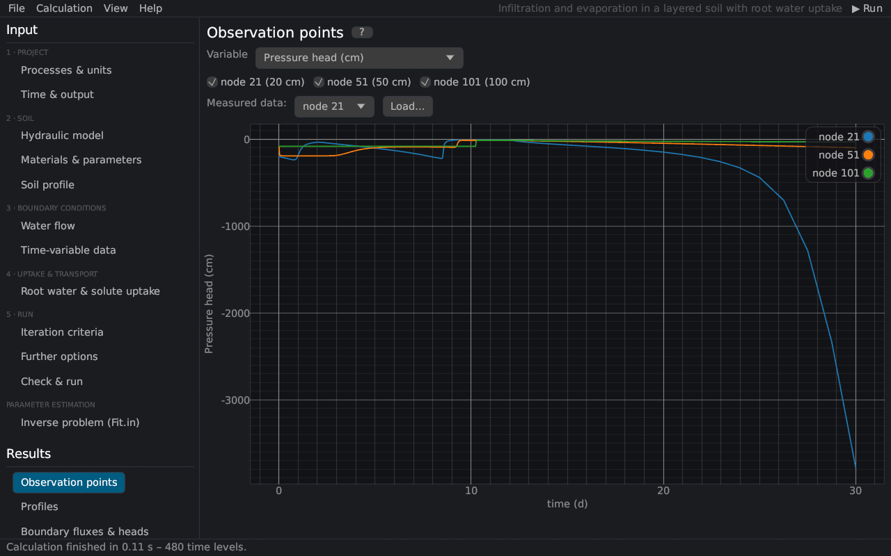

# Observation points
keywords: observation nodes; observation points; time series; Obs_Node; breakthrough curve

The page shows the values at the observation nodes against time, as *Observation Points* in HYDRUS-1D (file `Obs_Node.out`, here `OBS_NODE.csv`).

| Control | Description |
|---|---|
| Variable | pressure head, water content, temperature, flux or the concentration of a solute |
| Nodes | check boxes of the observation nodes with their depths |
| Measured data | *Load…* adds measured values (time, value) of the chosen observation node as points ([measured data](measured_data)) |

The observation nodes are defined on the page [Soil profile](profile_editor#observation). Resting the mouse on a curve shows the values; drag to pan, Ctrl+scroll to zoom, double-click to reset the axes. Concentrations against time at the bottom node or at depth form breakthrough curves.
