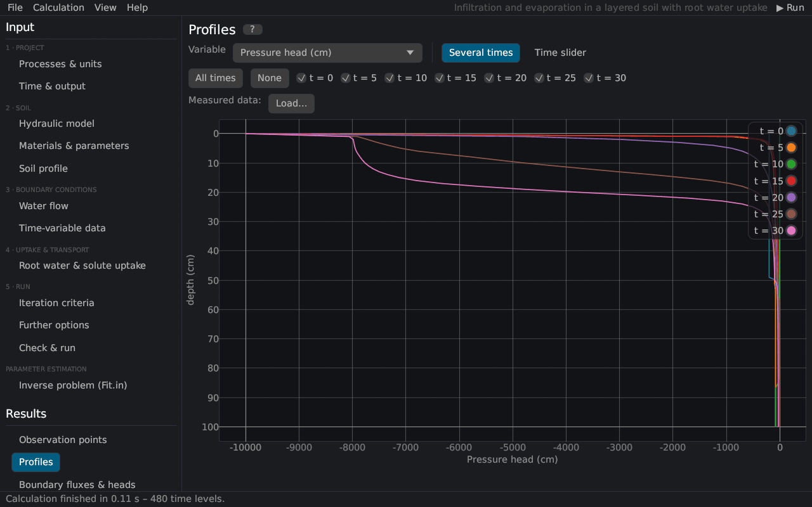

# Profiles
keywords: profile information; profiles; print times; Nod_Inf; pressure head profile; water content profile; time slider; animation

The page shows nodal values against depth at the print times, as *Profile Information* in HYDRUS-1D (file `Nod_Inf.out`, here `NOD_INF.csv`).

| Control | Description |
|---|---|
| Variable | pressure head, water content, hydraulic conductivity, water capacity, flux, root water uptake, v/Ks of the top node, temperature, concentrations and sorbed / immobile concentrations of each solute |
| Several times | the profiles of the checked print times together (*All times*, *None*) |
| Time slider | one print time at a time on fixed axes; ▶ plays through the print times, \|◀ and ▶\| step |
| Measured data | *Load…* adds measured values (depth, value) for the first shown print time ([measured data](measured_data)) |

The print times are set on the page [Time & output](time_output). The profiles of a run can serve as the initial condition of a new run ([soil profile](profile_editor)).
