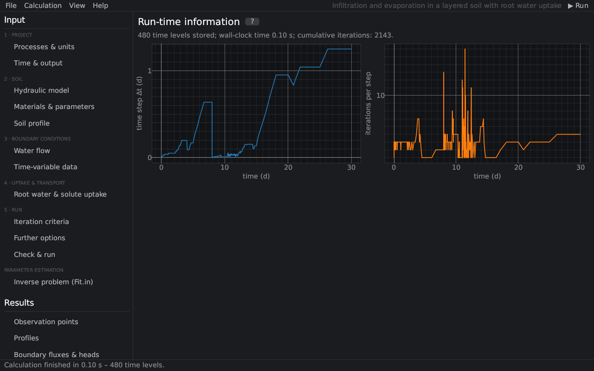

# Run-time information
keywords: run time information; time steps; iterations; Peclet number; Courant number; Run_Inf; performance

The page shows how the calculation went, as *Run Time Information* in HYDRUS-1D (file `Run_Inf.out`).

The header gives the number of time levels, the duration of the calculation and the cumulative number of iterations, followed by the messages of the run (e.g. why it stopped). The plots show against time (Peclet and Courant numbers only with solute transport):

| Plot | Meaning |
|---|---|
| time step Δt | the adaptive time step ([time step control](th_numerics#timestep)) |
| iterations per step | iterations of the water flow; many steps at the maximum mean convergence problems |
| maximum Peclet number | Pe = \|q\| Δz / (θ D) of the solute transport ([discretization](th_discretization)) |
| maximum Courant number | Cr = \|q\| Δt / (θ R Δz) |

Small time steps over long periods point to difficult conditions (infiltration into very dry soil, ponding, sharp layer contrasts); see [questions and problems](faq).
