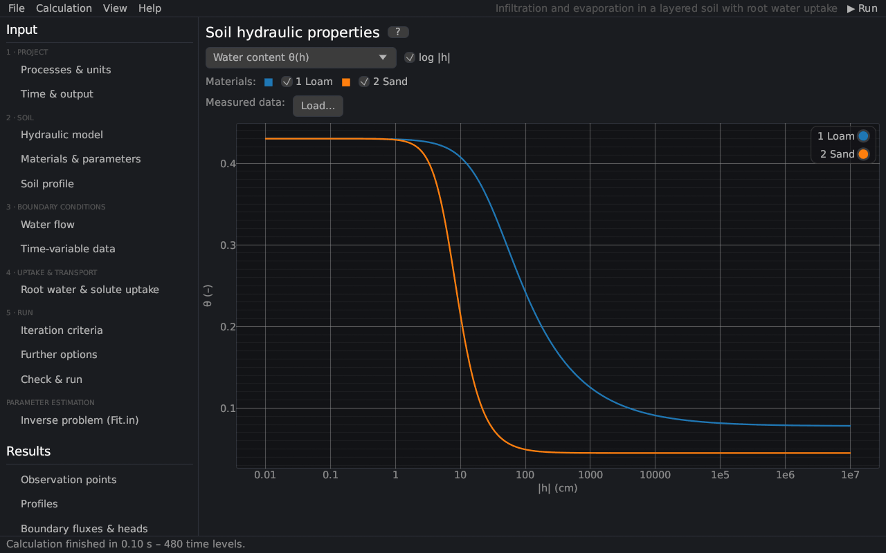

# Soil hydraulic properties
keywords: soil hydraulic properties; retention curve; conductivity function; water capacity; theta(h); K(h); K(theta); C(h); hysteresis curves

The page draws the hydraulic functions of the materials, as *Soil Hydraulic Properties* in HYDRUS-1D. It is available before a run.

| Control | Description |
|---|---|
| Curve | water content θ(h), hydraulic conductivity K(h), K(θ) or water capacity C(h) = dθ/dh |
| log \|h\| | logarithmic axis of the absolute pressure head |
| log y | logarithmic y axis (conductivity, capacity) |
| main wetting curve (dashed) | with hysteresis: also the main wetting curve |
| Materials | check boxes: several materials together |
| Measured data | *Load…* adds measured retention points (h, θ) or conductivities (h, K) ([measured data](measured_data)) |

The curves follow the [hydraulic model](th_hydraulic_models) and the parameters of the page [Materials & parameters](soil_params) (with look-up tables: the tables). Scanning curves of the hysteresis model depend on the history and are not drawn.
