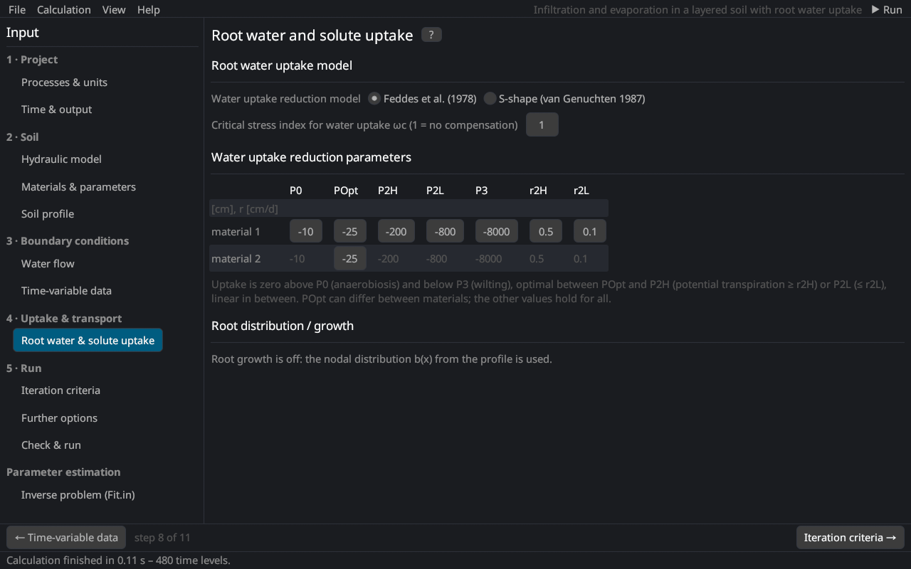

# Root water and solute uptake
keywords: root water uptake; Feddes; S-shape; water stress; osmotic stress; solute stress; compensation; omega c; passive uptake; active uptake; Michaelis-Menten; root growth; logistic growth

The page follows the *Root Water and Solute Uptake Model* dialog of HYDRUS-1D 4.17 together with the *Root Growth* parameters. The equations are in [root water uptake](th_root_uptake) and [root solute uptake](th_root_solute).

## Root water uptake model

| Input | Description |
|---|---|
| Water uptake reduction model | *Feddes et al. (1978)* [@feddes1978] or *S-shape* [@vanGenuchten1987] |
| Solute stress model | none, additive or multiplicative (threshold [@maasHoffman1977] or S-shape) |
| Critical stress index ωc | compensated uptake [@jarvis1989; @simunekHopmans2009]: 1 = no compensation, smaller values let unstressed roots compensate stressed ones |

## Feddes parameters

| Parameter | Description |
|---|---|
| P0 | head above which no water is taken up (anaerobiosis) [L] |
| POpt | head below which the uptake is optimal; can differ between materials [L] |
| P2H, P2L | heads below which the uptake decreases, for a potential transpiration of r2H and r2L [L] |
| P3 | wilting point: no uptake below it [L] |
| r2H, r2L | potential transpiration rates of P2H and P2L [L/T] (0.5 and 0.1 cm/d) |

For the S-shape function: P50, the pressure head of 50 % uptake, and the exponent p.

## Solute stress parameters

The osmotic coefficients (osmotic head per unit concentration) of each solute convert concentrations into the osmotic head. Multiplicative stress uses a threshold and a slope [@maas1990], or c50 and p of the S-shape.

## Root solute uptake

| Input | Description |
|---|---|
| cRoot (per solute) | maximum concentration of passive uptake: passive uptake = water uptake × min(c, cRoot); 0 = no passive uptake |
| Active solute uptake | Michaelis–Menten uptake of one solute [@simunekHopmans2009] |
| Solute with active uptake | the solute taken up actively (HYDRUS 4.17) |
| Potential solute uptake rate | [M/L²/T]; with time-variable boundary conditions from the cBot column of this solute |
| Michaelis–Menten constant Km | [M/L³] |
| Minimum concentration for uptake | [M/L³] |
| Critical stress index for active uptake | compensation of the active uptake (1 = none) |
| Reduced potential solute uptake … | the potential active uptake is reduced with the water stress |

## Root distribution and growth {#growth}

Without root growth the nodal root distribution b(x) of the [soil profile](profile_editor) is used. With root growth:

| Option | Description |
|---|---|
| Rooting depth from atmospheric data | the xRoot column of the time-variable data |
| Table (time, depth) | interpolated from a table |
| Logistic (Verhulst–Pearl) | growth between sowing and harvest after the logistic function [@simunekSuarez1993] with the initial root depth, the root depth at a known time, the maximum root depth and a period for repeated cycles |

See [root growth](th_root_uptake#growth) for the equations.
