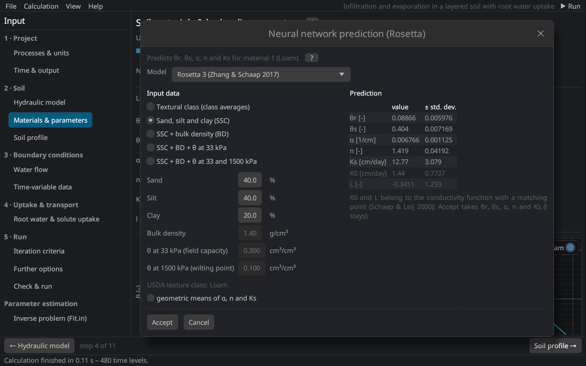

# Neural network prediction (Rosetta)
keywords: Rosetta; pedotransfer functions; PTF; texture; sand silt clay; bulk density; neural network; Rosetta 3; Rosetta Lite

The dialog predicts the van Genuchten parameters θr, θs, α, n and Ks from soil data with the Rosetta pedotransfer functions [@schaap2001; @zhangSchaap2017], as the Rosetta Lite dialog of HYDRUS-1D. It opens from *Neural network prediction (Rosetta)…* on the page [Materials & parameters](soil_params) and from *Rosetta…* next to the soil catalog of the [parameter estimation](inverse_page) (initial estimates).

## Input data

Rosetta is hierarchical: the more data, the better the prediction.

| Model | Input |
|---|---|
| H1 Textural class | the USDA textural class; gives the average parameters of the class in the Rosetta database |
| H2 SSC | sand, silt and clay [%] (sum 99–101 %) |
| H3 SSC + BD | and the bulk density [g/cm³] (0.5–2) |
| H4 SSC + BD + θ33 | and the water content at 33 kPa (field capacity) |
| H5 SSC + BD + θ33 + θ1500 | and the water content at 1500 kPa (wilting point) |

The USDA texture class of the entered fractions is shown below the inputs.

## Models

| Version | Description |
|---|---|
| Rosetta 3 (default) | One network for the retention parameters and Ks, recalibrated with weights from the uncertainty of the fitted retention curves and 1000 bootstrap members [@zhangSchaap2017]. |
| Rosetta 2 | Rosetta 1 with the retention parameters corrected after Schaap et al. [@schaap2004]. |
| Rosetta 1 | The models of Rosetta Lite in HYDRUS-1D [@schaap2001]. |

All are ensembles of neural networks trained on bootstrap samples; the prediction is the ensemble mean, shown with its standard deviation. *Geometric means* uses 10 to the mean of the logarithms of α, n and Ks instead of the arithmetic means. The network weights are those of the Python package rosetta-soil [@rosettaSoil]; the unit tests reproduce its predictions.

## Result

The prediction is given in cm and days, with K0 and L of the conductivity function with a matching point [@schaapLeij2000] for information. *Accept* writes θr, θs, α, n and Ks, converted to the project's units, into the material (or the initial estimates); l stays.

> Pedotransfer functions give approximate parameters for a soil like the soils of their database (mostly temperate agricultural soils). Measured retention data or a [parameter estimation](th_inverse) are better when available.

See also: [pedotransfer functions](th_rosetta).
