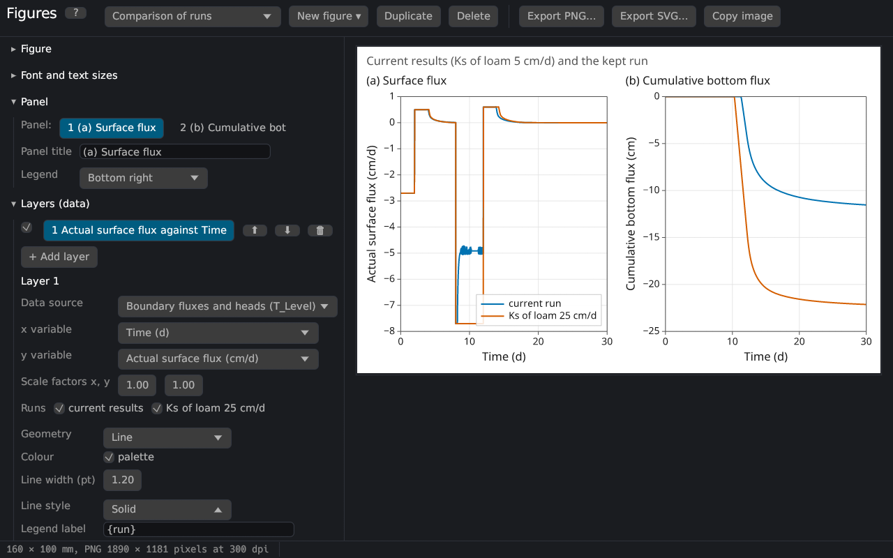

# Comparison of runs
keywords: comparison; compare runs; kept run; scenario; sensitivity; keep results; load run; save run; JSON; results file; --json

The figures can show the results of several runs together, e.g. to compare scenarios (with and without irrigation), parameter values (a sensitivity analysis of Ks or n) or two soil profiles. A run is kept with its project, so runs with different units, profiles or print times can be compared.

## Keeping and loading runs

In the section **Runs for comparison** of the [figure editor](figures):

1. Run the calculation.
2. Enter a name (e.g. "Ks 25 cm/d") and click **Keep current results**.
3. Change the input, run again, and repeat for further runs.

The kept runs stay until the program closes; they are not saved with the project. **Save…** writes a run to a file (JSON with the project and the results), **Load run…** reads such a file or the results written by the command line program with `--json` (see [Command line](cli)); results without their project take the units and the profile of the current project.

## Showing runs in a figure

The settings of a layer have a row **Runs** with the current results and the kept runs; every selected run adds its series to the layer. The legend names the run ("current results" or the name of the kept run); a legend label with `{run}` places the name where you want it.

When a layer shows several items (e.g. three observation nodes) of several runs, the colour shows the item and the line style the run (solid, dashed, dotted, dash-dot) — the markers change with the run, too. With one item the runs get the colours of the palette.

The template **Comparison of runs** (with at least one kept run) shows the surface flux and the cumulative bottom flux of the current results and all kept runs.

Sources that do not depend on a run (measured data, imported tables, the observed and fitted values of a parameter estimation) are shown once.

## Hints

- Name runs after what differs ("no roots", "Ks × 0.5"), not after their number: the names appear in the legends.
- For a sensitivity analysis keep one run per parameter value and show one variable of all runs, e.g. the cumulative bottom flux.
- The relative water balance error of each run ([Mass balance](res_balance)) can be shown in one figure to check the runs.
