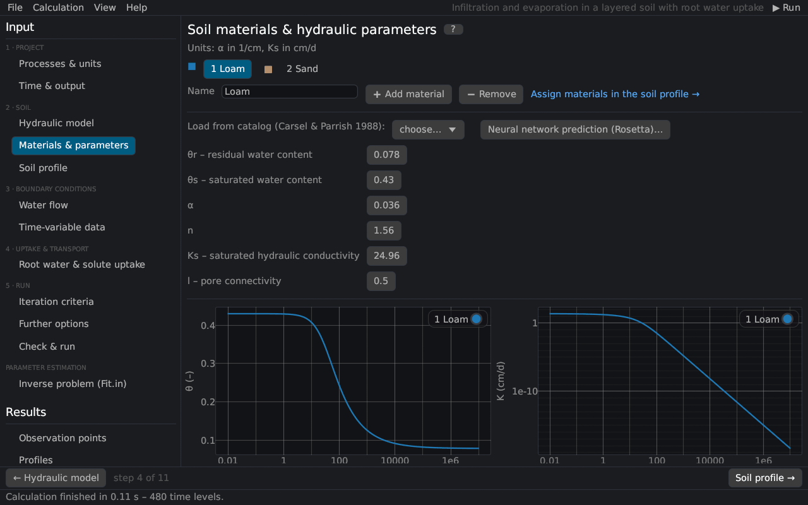

# Materials & parameters
keywords: soil hydraulic parameters; materials; soil catalog; Carsel Parrish; theta r; theta s; alpha; n; Ks; l; pore connectivity; Rosetta; add material

Each material (soil layer type) has its soil hydraulic parameters. The page corresponds to the *Water Flow Parameters* dialog of HYDRUS-1D; it also adds, removes and renames materials and draws θ(h) and K(h) of the selected material.

## Materials

Click a material in the list to edit it. *➕ Add material* adds a copy of the selected material with all its water, heat, solute and root parameters; *➖ Remove* deletes it (nodes of this material get the material before it). Materials are assigned to the nodes on the page [Soil profile](profile_editor). The name is shown in the profile and the plots (HYDRUS-1D files do not store it).

## Parameters

The units are those of the project: α in 1/L, Ks in L/T.

| Parameter | HYDRUS | Description |
|---|---|---|
| θr | Qr | Residual water content [–]. |
| θs | Qs | Saturated water content [–]. |
| α | Alpha | Parameter of the retention function [1/L], roughly the inverse of the air-entry head. Brooks–Corey: inverse of the air-entry value; Kosugi: the median head hm. |
| n | n | Shape parameter [–] (> 1), the steeper the retention curve the larger n. Brooks–Corey: pore-size distribution index λ; Kosugi: standard deviation σ. |
| Ks | Ks | Saturated hydraulic conductivity [L/T]. |
| l | l | Pore-connectivity parameter of the conductivity function [–]. |

Further parameters of the models:

| Model | Parameters |
|---|---|
| Modified van Genuchten | θm (extrapolated water content at h = 0, ≥ θs), θa (≤ θr), θk and Kk (a measured point of K(θ)) [@vogelCislerova1988] |
| Durner | w2 (weight of the second pore system), α2, n2 [@durner1994] |
| Dual porosity, water-content transfer | θr,im, θs,im of the immobile region, ω [1/T] |
| Dual porosity, head transfer | θr,im, θs,im, α_im, n_im of the immobile region, ω |
| Dual permeability | θr,m, θs,m, α_m, n_m, Ks,m of the matrix (the primary columns describe the fractures) |
| Hysteresis | θm (drying), θs, α and (with hysteresis in K) Ks of the main wetting curve |

## The parameter l {#l}

The parameter l represents the tortuosity and connectivity of the pores. Mualem [@mualem1976] estimated it as 0.5 for many soils, but there is no general agreement; from the UNSODA database, Schaap and Leij [@schaapLeij2000] found a mean of about −1 together with a matching conductivity K0 below Ks. Since the shape parameters α and n of the conductivity function come from the retention curve, l is the only parameter that shapes K(h) independently – useful in the [parameter estimation](th_inverse) from outflow or evaporation experiments.

## Soil catalog {#catalog}

*Load from catalog* enters the average van Genuchten parameters of the 12 USDA textural classes of Carsel and Parrish [@carselParrish1988], converted to the project's units (l = 0.5). The values were derived statistically from the data of Rawls et al. [@rawls1982]; they are only rough averages of each class.

| Texture | θr | θs | α [1/cm] | n | Ks [cm/d] |
|---|---|---|---|---|---|
| Sand | 0.045 | 0.43 | 0.145 | 2.68 | 712.8 |
| Loamy sand | 0.057 | 0.41 | 0.124 | 2.28 | 350.2 |
| Sandy loam | 0.065 | 0.41 | 0.075 | 1.89 | 106.1 |
| Loam | 0.078 | 0.43 | 0.036 | 1.56 | 24.96 |
| Silt | 0.034 | 0.46 | 0.016 | 1.37 | 6.0 |
| Silt loam | 0.067 | 0.45 | 0.020 | 1.41 | 10.8 |
| Sandy clay loam | 0.100 | 0.39 | 0.059 | 1.48 | 31.44 |
| Clay loam | 0.095 | 0.41 | 0.019 | 1.31 | 6.24 |
| Silty clay loam | 0.089 | 0.43 | 0.010 | 1.23 | 1.68 |
| Sandy clay | 0.100 | 0.38 | 0.027 | 1.23 | 2.88 |
| Silty clay | 0.070 | 0.36 | 0.005 | 1.09 | 0.48 |
| Clay | 0.068 | 0.38 | 0.008 | 1.09 | 4.8 |

## Neural network prediction (Rosetta)

*Neural network prediction (Rosetta)…* predicts θr, θs, α, n and Ks from the texture, the bulk density and measured water contents ([Rosetta](rosetta)).

## Curves

Below the parameters the retention curve θ(h) and the conductivity K(h) of the material are drawn (with hysteresis also the main wetting curve). More curves – K(θ), C(h), linear axes, several materials – are on the results page [Soil hydraulic properties](res_soilprops), which is available before a run as well.
