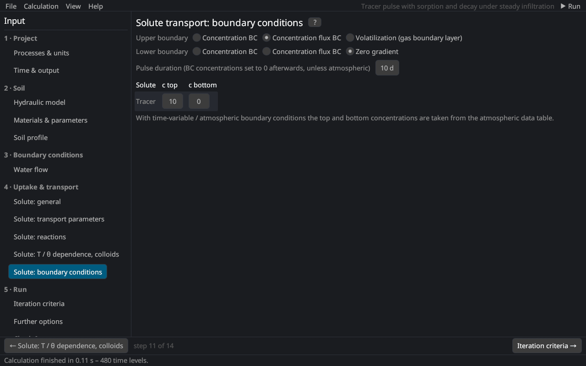

# Solute transport: boundary conditions
keywords: solute boundary conditions; concentration boundary condition; concentration flux; Cauchy; Dirichlet; zero gradient; volatilization; pulse duration

The page corresponds to the *Solute Transport Boundary Conditions* dialog of HYDRUS-1D. The equations are in [solute transport](th_solute#bc).

## Upper boundary

| Condition | Description |
|---|---|
| Concentration BC | first type: the concentration of the top node is prescribed |
| Concentration flux BC | third type: the solute flux equals the water flux times the concentration of the entering water; recommended for the soil surface (no solute enters with evaporation) |
| Volatilization | concentration flux plus gas diffusion through a stagnant boundary layer of thickness dSurf to the atmosphere with the concentration cAtm [@jury1983] |

## Lower boundary

| Condition | Description |
|---|---|
| Concentration BC | first type |
| Concentration flux BC | third type |
| Zero gradient | ∂c/∂z = 0: solute leaves the profile by advection only (deep profiles, free drainage) |

## Concentrations

*c top* and *c bottom* per solute [M/L³]; with time-variable or atmospheric boundary conditions the concentrations come from the cTop and cBot columns of the [time-variable data](time_variable_bc). *Pulse duration*: after this time [T] the boundary concentrations are set to 0 – only without an atmospheric boundary condition.
