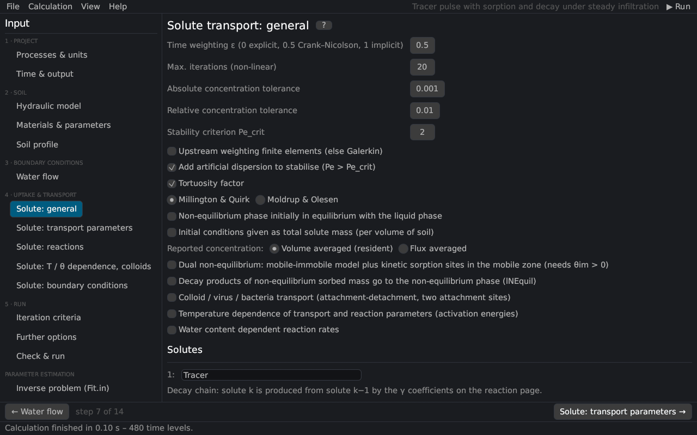

# Solute transport: general
keywords: solute transport; general solute information; time weighting; Crank-Nicolson; upstream weighting; artificial dispersion; Peclet; tortuosity; Millington Quirk; non-equilibrium; colloids; number of solutes

The page corresponds to the *General Solute Transport Information* dialog of HYDRUS-1D: the numerical scheme, the transport model and the names of the solutes. The equations are in [solute transport](th_solute).

## Numerical scheme

| Input | Description |
|---|---|
| Time weighting ε | 0 explicit, 0.5 Crank–Nicolson (default, second order), 1 fully implicit |
| Max. iterations (non-linear) | iterations per time step with non-linear sorption |
| Absolute / relative concentration tolerance | convergence of the iteration with non-linear sorption |
| Stability criterion Pe_crit | Pe·Cr ≤ Pe_crit (default 2) [@perrochetBerod1993] |
| Upstream weighting | upstream-weighted finite elements [@christie1976] instead of Galerkin; damps oscillations at sharp fronts |
| Add artificial dispersion | with Galerkin elements, artificial dispersion is added where the stability criterion is not met |

See [numerical solution](th_numerics#solute) and [discretization](th_discretization).

## Transport model

| Input | Description |
|---|---|
| Tortuosity factor | molecular diffusion reduced by the tortuosity of the liquid and gas phases, after [@millingtonQuirk1961] or Moldrup and Olesen [@moldrup1997; @moldrup2000] |
| Non-equilibrium phase initially in equilibrium | the initial kinetically sorbed or immobile concentrations are in equilibrium with the liquid |
| Initial conditions as total solute mass | the initial concentrations of the profile are total masses per volume of soil |
| Reported concentration | resident (volume-averaged) or flux-averaged concentrations |
| Dual non-equilibrium | mobile–immobile water plus kinetic sorption sites in the mobile zone (needs θim > 0) [@simunekVG2008] |
| Decay products … to the non-equilibrium phase | the daughter products of the kinetically sorbed mass enter the kinetic sites of the next solute (lNEquil) |
| Colloid / virus / bacteria transport | two kinetic attachment–detachment sites with blocking and straining [@schijvenSimunek2002; @bradford2003] ([colloids](th_colloids)); optionally with attachment from filtration theory |
| Temperature dependence | Arrhenius dependence of the transport and reaction parameters [@stummMorgan1981] |
| Water content dependent reaction rates | after [@walker1974] or trapezoidal functions per reaction ([theory](th_reaction_dependence)) |

## Solutes

The names of the solutes (as many as set on [Processes & units](processes)). Solutes form a decay chain: solute k is produced from solute k−1 by the first-order coefficients γ on the [reaction page](solute_reactions).
