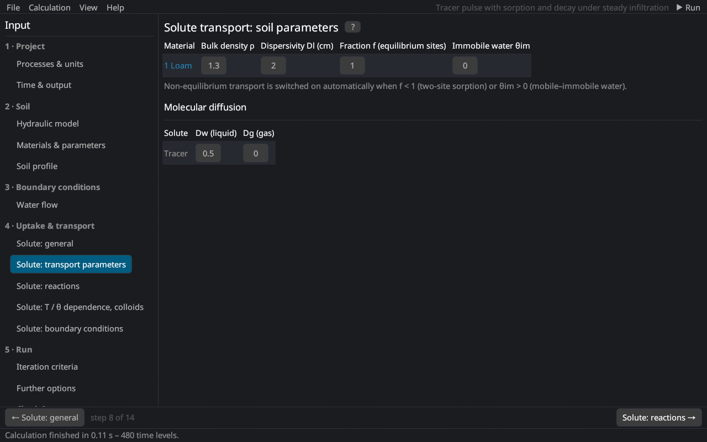

# Solute transport: transport parameters
keywords: solute transport parameters; bulk density; dispersivity; fraction of equilibrium sites; immobile water content; molecular diffusion; diffusion coefficient

The soil-specific transport parameters (per material) and the molecular diffusion coefficients (per solute), the first part of the *Solute Transport Parameters* dialog of HYDRUS-1D.

## Per material

| Parameter | HYDRUS | Description |
|---|---|---|
| Bulk density ρ | Bulk.d. | dry bulk density [M/L³], in the project's mass and length units (e.g. 1.5 g/cm³ with mass unit g and cm) |
| Dispersivity Dl | DisperL. | longitudinal dispersivity [L]; the dispersion coefficient is D = Dl \|q\|/θ + Dw τw [@bear1972] |
| Fraction f | Frac | fraction of the sorption sites in equilibrium with the liquid (two-site model) [–]; 1 = equilibrium sorption. With mobile–immobile water: fraction of sites in contact with mobile water |
| Immobile water θim | ThImob | immobile water content of the mobile–immobile model [–]; 0 = none [@vanGenuchtenWierenga1976] |
| Immobile water θim (matrix) | – | dual permeability: immobile water content of the matrix domain |

Non-equilibrium transport is switched on automatically when f < 1 (two-site sorption) or θim > 0 (mobile–immobile water) ([non-equilibrium transport](th_nonequilibrium)).

Typical dispersivities are a few millimetres to centimetres in laboratory columns and about one tenth of the travel distance in the field.

## Molecular diffusion

| Parameter | Description |
|---|---|
| Dw | diffusion coefficient in free water [L²/T] (small ions about 1–2 cm²/d) |
| Dg | diffusion coefficient in the soil air [L²/T] (volatile solutes, about 10⁴ times Dw) |

With the tortuosity factor ([general](solute_general)) the effective diffusion is θ D_{w} τ_{w} in the liquid and a_{v} D_{g} τ_{g} in the gas phase.
