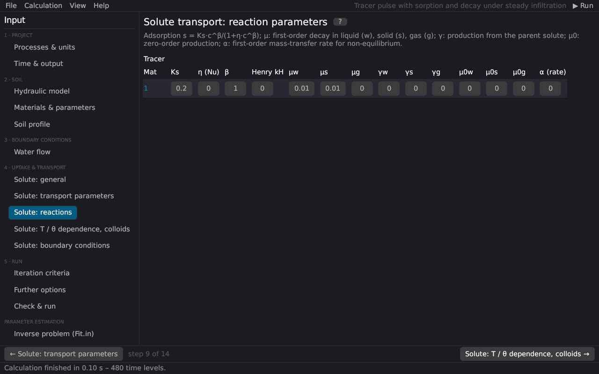

# Solute transport: reactions
keywords: reaction parameters; sorption; Freundlich; Langmuir; Kd; Henry; decay; first-order; zero-order; production; decay chain; non-equilibrium rate

The reaction parameters per solute and material, the second part of the *Solute Transport Parameters* dialog of HYDRUS-1D (*Solute Reaction Parameters*). The equations are in [solute transport](th_solute).

## Parameters

| Parameter | HYDRUS | Description |
|---|---|---|
| Ks | Kd | adsorption coefficient [L³/M] of the isotherm s = Ks c^{β}/(1 + η c^{β}); for linear sorption the distribution coefficient Kd |
| η | Nu | Langmuir coefficient [L³/M]; 0 = Freundlich or linear |
| β | Beta | Freundlich exponent [–]; 1 = linear |
| Henry kH | Henry | Henry's constant, g = kH c [–] (volatile solutes) [@jury1983] |
| μw, μs, μg | SinkL1, SinkS1, SinkG1 | first-order decay constants in the liquid, solid and gas phases [1/T] |
| γw, γs, γg | SinkL1', SinkS1', SinkG1' | first-order production of this solute from the previous one (decay chain) [1/T] |
| μ0w, μ0s, μ0g | SinkL0, SinkS0, SinkG0 | zero-order production in the three phases [M/L³/T, 1/T] (negative values: zero-order decay) |
| α (rate) | Alfa | first-order rate of the non-equilibrium exchange: kinetic sorption sites (f < 1) or mobile–immobile water (θim > 0) [1/T] |
| αs | – | dual permeability: solute transfer coefficient between the fractures and the matrix [1/T] |

With *dual non-equilibrium* the columns μg and γg are reused: μg is the fraction f_{em} of equilibrium sites in the mobile zone and γg the rate ω_{S} of the kinetic sites, as in HYDRUS-1D. With the colloid model the columns are reused for the attachment parameters ([colloids](solute_advanced)).

## Hints

- For a conservative tracer leave all reaction parameters at 0 (Ks = 0, β = 1).
- The retardation factor of linear sorption is R = 1 + ρ Kd / θ.
- The half-life of first-order decay is t_{1/2} = ln 2 / μ.

See also: [non-equilibrium transport](th_nonequilibrium) · [temperature and water-content dependence](th_reaction_dependence)
