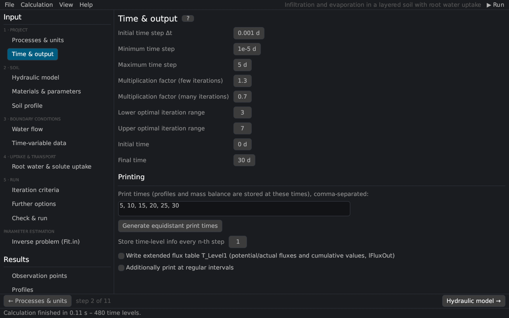

# Time & output
keywords: time information; time step; dtMin; dtMax; print times; output; initial time; final time; time discretization

The page combines the *Time Information* and *Print Information* dialogs of HYDRUS-1D: the simulated period, the limits of the adaptive time step and the times at which results are stored.

## Time discretization

| Input | HYDRUS | Description |
|---|---|---|
| Initial time step Δt | dt | First time step [T]; the step then adapts to the convergence of the iteration. |
| Minimum time step | dtMin | Smallest allowed time step [T]. |
| Maximum time step | dtMax | Largest allowed time step [T]. |
| Multiplication factor (few iterations) | dMul | Factor > 1 (1.3) applied when the iteration converged within the lower optimal iteration range. |
| Multiplication factor (many iterations) | dMul2 | Factor < 1 (0.7) applied when the iteration needed more than the upper optimal iteration range. |
| Lower / upper optimal iteration range | ItMin, ItMax | 3 and 7 by default. |
| Initial time, final time | tInit, tMax | Simulated period [T]. |

The time step is adjusted automatically ([time step control](th_numerics#timestep)): after a step that converged in at most ItMin iterations it is multiplied by dMul, after a step that needed at least ItMax iterations by dMul2; if the iteration does not converge within the maximum number of iterations ([Iteration criteria](iteration)) the step is repeated with Δt/3. Time steps always end at print times and at the times of the time-variable boundary records. The solute and heat transport can limit the step further (Courant number).

## Printing

| Input | Description |
|---|---|
| Print times | Times at which profiles, the mass balance and the results pages store values; comma- or blank-separated. *Generate equidistant print times* creates 10 times between the initial and the final time. |
| Store time-level info every n-th step | nPrStep: thins the time-level tables (T_LEVEL, Obs_Node). |
| Write extended flux table T_Level1 | lFluxOut: potential and actual fluxes and further cumulative values ([output files](output_files#tlevel1)). |
| Additionally print at regular intervals | lPrintD with the interval tPrintInt. |

## Hints

- A small initial time step (e.g. 0.001 d) helps the first steps of infiltration into dry soil; the program enlarges it quickly.
- dtMax limits the smoothness of the output and the accuracy at strong changes of the boundary conditions; values of 1/10 of the shortest boundary record are a reasonable start.
- Many print times cost memory (all profiles are kept in memory).

See also: [Notes on spatial and temporal discretization](th_discretization).
