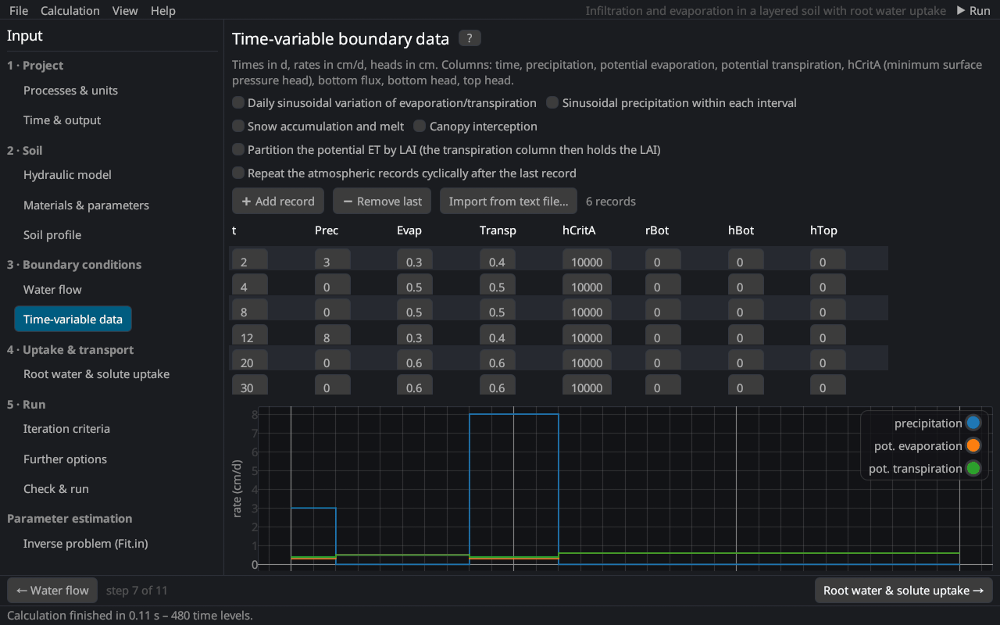

# Time-variable boundary data
keywords: atmospheric data; ATMOSPH.IN; precipitation; evaporation; transpiration; hCritA; time-variable boundary conditions; snow; interception; LAI; daily variation; records

With an atmospheric or another time-variable boundary condition, the boundary values come from a table of records, the file `ATMOSPH.IN` of HYDRUS-1D (*Time-Variable Boundary Conditions* dialog). Each record holds from the end of the previous record (or the initial time) to its time t.

## Columns

| Column | Description |
|---|---|
| t | end time of the record [T] |
| Prec | precipitation (and irrigation) [L/T] |
| Evap | potential evaporation [L/T] (with LAI partitioning: potential evapotranspiration; with a variable head/flux top: the code KodTop) |
| Transp | potential transpiration [L/T] (with LAI partitioning: the leaf area index) |
| hCritA | absolute value of the minimum pressure head at the surface [L]: below it the surface turns into a head condition and the evaporation is reduced (e.g. 10⁴–10⁵ cm) |
| rBot, hBot, hTop | bottom flux, bottom head, top head [L/T, L] for variable flux or head conditions |
| Ttop, Tbot, Ampl | temperatures at the top and the bottom and the amplitude of the daily surface temperature (heat transport) [°C] |
| cTop k, cBot k | concentrations of solute k at the top and the bottom [M/L³] (with active uptake: cBot of the actively taken-up solute is the potential uptake rate) |
| xRoot | rooting depth (root growth from the atmospheric data) [L] |

*➕ Add record* adds a copy of the last record one time unit later; *Import from text file…* reads records from a text or CSV file with at least 8 columns in the order of the table. The plot below the table shows precipitation, potential evaporation and transpiration as step functions.

## Options

| Option | Description |
|---|---|
| Daily sinusoidal variation of evaporation/transpiration | Distributes daily rates over the day: 24 % of the mean rate at night and a sine wave during the day [@fayer2000] ([theory](th_atmosphere#daily)). |
| Sinusoidal precipitation within each interval | The precipitation of each record follows a sine wave over its interval. |
| Snow accumulation and melt | Snow below −2 °C, rain above +2 °C, mixed in between; melt with the degree-day factor [L/T/°C] (Ttop is the air temperature) ([snow](th_atmosphere#snow)). |
| Canopy interception | Interception capacity a · LAI with the interception constant a [L] [@vonHoyningenHune1983; @braden1985]. |
| Partition the potential ET by LAI | The Evap column holds ETp and the Transp column the LAI; Tp = ETp (1 − e^{−k·LAI}) [@ritchie1972] with the extinction coefficient k (0.463). |
| Repeat the atmospheric records cyclically | After the last record the table starts again (lBCCycles). |

See also: [atmospheric boundary condition](th_bc_water#atmospheric) · [atmospheric inputs](th_atmosphere) · [meteorological data](meteo_page)
