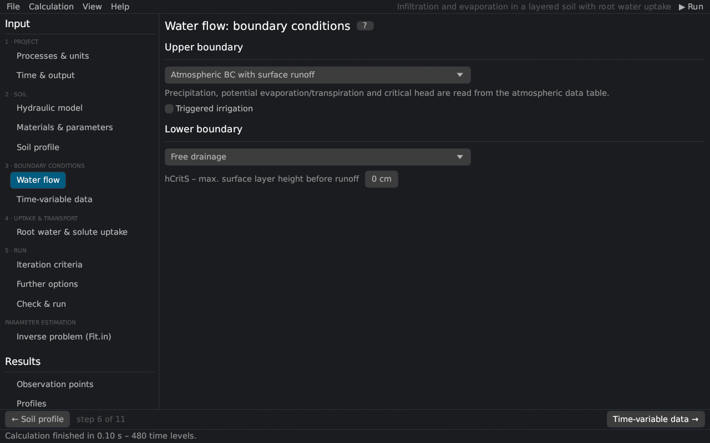

# Water flow boundary conditions
keywords: boundary conditions; upper boundary; lower boundary; atmospheric boundary condition; free drainage; deep drainage; seepage face; horizontal drains; constant head; constant flux; triggered irrigation; hCritS; runoff; ponding

The page sets the boundary conditions of the water flow at the soil surface and at the bottom of the profile (the *Water Flow Boundary Conditions* dialog of HYDRUS-1D). The equations are in [boundary conditions](th_bc_water).

## Upper boundary

| Condition | Description |
|---|---|
| Constant pressure head | The head of the top node keeps its initial value (set it on the page [Soil profile](profile_editor)). |
| Constant flux | A constant flux rTop [L/T]; negative = infiltration. |
| Atmospheric BC with surface layer | Precipitation and potential evaporation from the [time-variable data](time_variable_bc); water that cannot infiltrate ponds at the surface up to hCritS and then runs off; evaporation is limited by the dry limit hCritA [@neuman1974]. |
| Atmospheric BC with surface runoff | As above without ponding: excess water runs off immediately. |
| Variable pressure head | Head hTop of the time-variable data. |
| Variable flux | Flux Evap − Prec of the time-variable data. |
| Variable pressure head / flux | Each record decides with the code in the Evap column (positive: head, negative: flux). |

**hCritS** is the maximum height of water at the surface before runoff (with the surface layer; 0 = no ponding). **Constant potential transpiration** is the potential transpiration with constant boundary conditions and root water uptake.

## Triggered irrigation {#irrigation}

With an atmospheric upper boundary, irrigation can be triggered by the pressure head at an observation node [@simunek2016]:

| Input | Description |
|---|---|
| Observation node | number in the list of observation nodes (1 = first) |
| Pressure head triggering irrigation | threshold [L]; the irrigation is triggered when the head falls below it |
| Irrigation rate | [L/T] |
| Irrigation duration | [T] |
| Lag time | time between the trigger and the start [T] |
| Behaviour | *As HYDRUS 4.17*: the rate replaces the precipitation; the next atmospheric record ends the irrigation, and its end removes the precipitation until the following record. *Full duration*: the rate is added to the precipitation for the whole duration (Rusteau option, not stored in HYDRUS-1D projects). |

The irrigation events are written to `IRRIG.csv` ([output files](output_files#irrig)).

## Lower boundary

| Condition | Description |
|---|---|
| Constant pressure head | The head of the bottom node keeps its initial value (e.g. a groundwater table). |
| Constant flux | A constant flux rBot [L/T]; positive = upward (into the profile). |
| Variable pressure head / flux | hBot or rBot of the time-variable data. |
| Free drainage | Unit hydraulic gradient: the water leaves with the conductivity of the bottom node; for deep water tables. |
| Deep drainage | q = −Aqh exp(Bqh \|h − GWL0L\|) with the reference groundwater level GWL0L [@hopmansStricker1989]. |
| Seepage face | No flux while the bottom is unsaturated; drains at the head hSeep (usually 0) when saturated; lysimeters and columns with an open bottom. |
| Horizontal drains | Discharge to parallel drains or ditches after [@hooghoudt1940] and [@ernst1962], as implemented in SWAP [@vanDam1997]. |

### Horizontal drains {#drains}

| Input | Description |
|---|---|
| Drain geometry / configuration | 1 homogeneous profile, drain on the impervious layer; 2 homogeneous, above the impervious layer; 3 layered, drain at the interface; 4 layered, drain in the bottom layer; 5 layered, drain in the top layer |
| Elevation of the drain bottom | z coordinate [L] (negative) |
| Drain spacing | distance between the drains [L] |
| Entrance resistance | [T] |
| Elevation of the impervious layer, wet perimeter | configurations 2–5 |
| Kh above / below the drain, Kv top / bottom, depth of the layer interface, geometry factor | conductivities of the layers, depending on the configuration |

See also: [time-variable boundary data](time_variable_bc) · [boundary conditions (theory)](th_bc_water)
